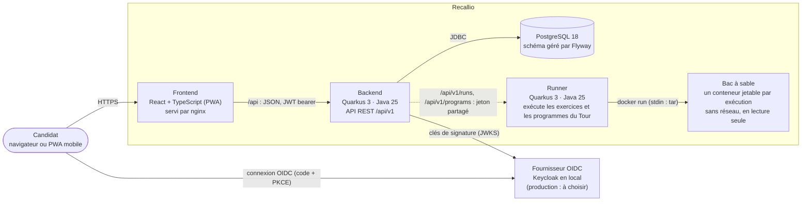
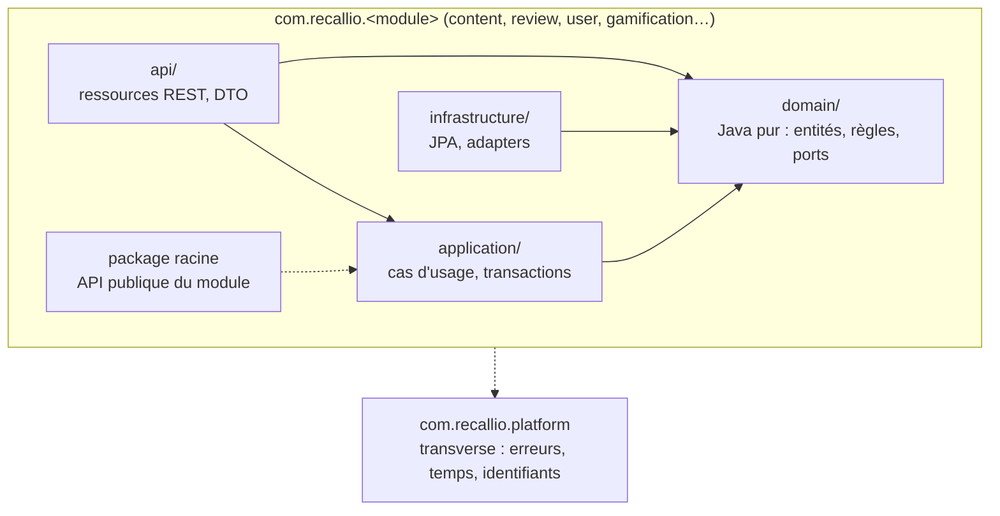
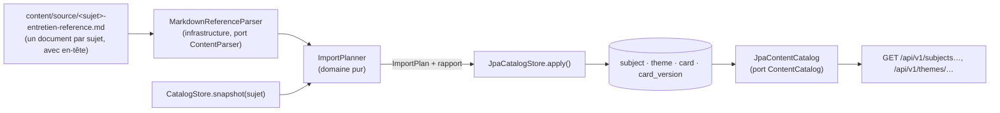
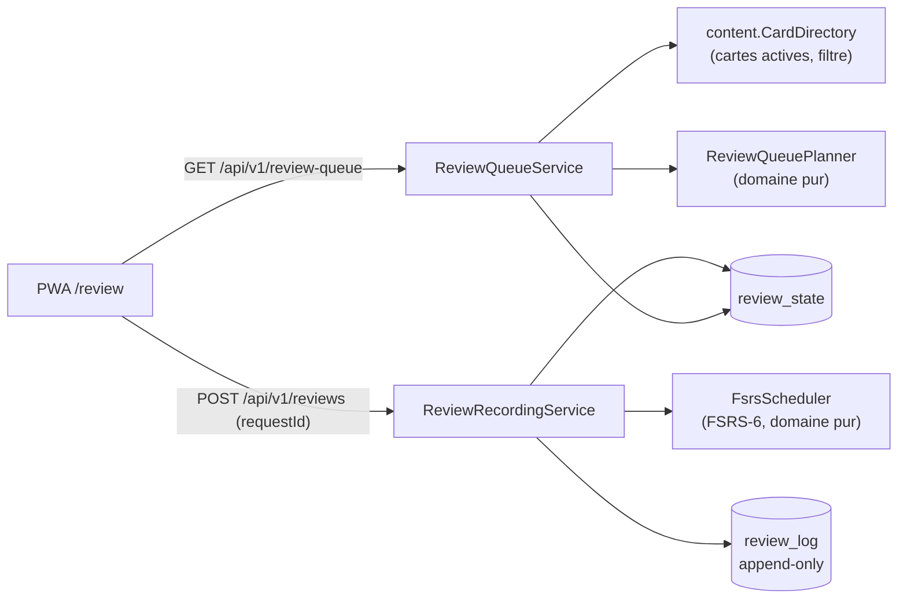
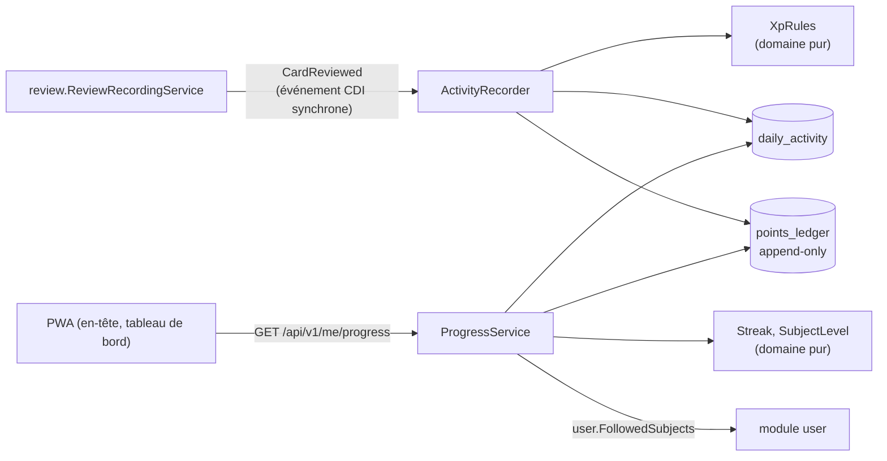
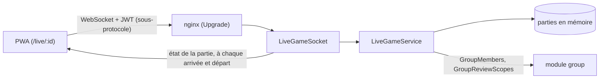
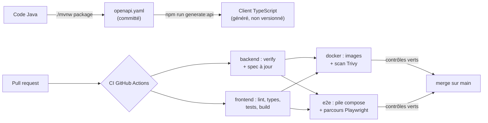

# Architecture de Recallio

> Document vivant, mis à jour à chaque étape. État : **phase 1, étape 2** (authentification OIDC et profil).
> Les décisions qui expliquent ces choix sont dans [docs/adr/](adr/).

## 1. Vue conteneurs (C4, niveau 2)

| Conteneur | Rôle | Technologies |
|---|---|---|
| Frontend | Interface de révision, installable sur mobile. Appelle l'API via un client **généré** depuis la spec OpenAPI. Son design system « Coach » (ADR 0049) ne passe que par des tokens, clairs et sombres. | React 19, Vite, TanStack Query, React Router, Tailwind, vite-plugin-pwa, CodeMirror 6 (exercices de code), Phosphor (icônes), Lexend et JetBrains Mono (servies par l'application) |
| Backend | Règles métier, API REST versionnée, validation des JWT. | Quarkus REST, Hibernate ORM, Hibernate Validator, SmallRye Health et OpenAPI |
| PostgreSQL | Données métier et progression. Le schéma est versionné par des migrations Flyway, jamais généré. | PostgreSQL 18 |
| Fournisseur OIDC | Authentification. Le backend ne connaît que le standard OIDC, pas le fournisseur. | Keycloak (local et Dev Services) |
| Runner | Juge un exercice par ses tests (`/api/v1/runs`, ADR 0030) ou lance un programme du Tour et renvoie ses sorties (`/api/v1/programs`, ADR 0037). Seul à accéder au socket Docker ; joint par le seul backend. | Quarkus REST, ligne de commande `docker`, commons-compress |
| Bac à sable | Un conteneur neuf par exécution : réseau coupé, système de fichiers en lecture seule, ressources plafonnées, utilisateur sans droits, délai. | Images `sandbox/java` (JDK 25, JUnit 6) et `sandbox/go` (Go 1.27, ADR 0033) |

En local avec Docker (`infra/compose.yaml`), nginx relaie `/api` vers le backend : le front et
l'API partagent la même origine, donc pas de CORS.

## 2. Vue composants du backend (C4, niveau 3)

Le backend est un **monolithe modulaire** (ADR 0001) : un module métier par package, découpé en
couches. Les règles ci-dessous sont **vérifiées à chaque build** par
[`ArchitectureTest`](../backend/src/test/java/com/recallio/ArchitectureTest.java).

| Règle | Pourquoi |
|---|---|
| `domain` ne dépend d'aucun framework (Quarkus, JPA, Jackson…) | Le cœur métier se teste unitairement, sans démarrer l'application. |
| Les dépendances vont vers l'intérieur | Un changement technique (base, framework) ne touche pas les règles métier. |
| Un module n'utilise que le **package racine** des autres modules | Les frontières restent explicites, et un module reste extractible. |
| Pas de cycle entre modules | Évite le « plat de spaghettis » en grandissant. |
| `platform` est utilisable par tous | Évite de dupliquer le transverse dans chaque module. |

**Modules prévus** : `content`, `review`, `user` et `gamification` (phase 1), `group` (phase 2),
`live` (phase 3), `feedback`, `ranked` et `notification` (phase 3 ter), `organization` (phase 4).

### Module `content` (en place)

| Élément | Rôle |
|---|---|
| `domain.CardContent` | Interface `sealed` : `Flashcard`, `CodeOutput`, `OpenScenario`, `Definition`, `MultipleChoice` (ses choix, ADR 0019). |
| `domain.Subject` | Un sujet du catalogue : slug définitif, catégorie, ordre, brouillon ou publié (ADR 0013). |
| `domain.CardIdentity` | Identifiants stables (UUID v8) dérivés du sujet, du chapitre et de la question (ADR 0009 et 0013). |
| `infrastructure.markdown.SubjectHeader` | Lit l'en-tête `---` d'un document : le sujet qu'il décrit. |
| `domain.importing.ImportPlanner` | Compare un document à son sujet en base : ajouts, nouvelles versions, retraits (dans ce sujet seulement), réactivations. |
| `application.ContentImportService` | Transaction d'import et journalisation du rapport. |
| `api.SubjectsResource`, `api.ThemesResource` | Catalogue public (contenu des brouillons visible des seuls admins), pagination bornée (100 cartes maximum par page). Chaque sujet dit s'il a un Tour (`hasTour`), et donc un essai sans compte (ADR 0050). `?upcoming=true` annonce aussi les brouillons, pour les pages Cours, Tour et Révisions ; `GET /api/v1/subjects/{s}/notions/{n}` sert la leçon d'une notion et ses voisines (ADR 0052). |
| `api.TourResource` | Le Tour d'un sujet, public comme le catalogue (ADR 0037) : `GET /api/v1/subjects/{s}/tour`, le sommaire par domaine et chapitre sans le contenu des pages, puis `/tour/{notion}`, les pages d'une notion. La solution et la sortie attendue d'un « À toi » restent sur le serveur. |
| `TourDirectory` (package racine), `infrastructure.persistence.JpaTourDirectory` | **API publique** : une page du Tour, « À toi » compris, pour que le module `review` le juge sans que sa sortie attendue ne quitte le backend. |
| `TourPage` (package racine) | Une page du Tour et ses règles : un programme d'un seul langage, `Main.java` en Java, un « À toi » aux fichiers de son code de départ (ADR 0037). |
| `domain.TourQuestions` | Les questions qui valident une notion du Tour : ses cartes corrigées par le serveur, une par format d'abord, trois au plus, dans l'ordre du fichier. Le parseur en exige deux (ADR 0037). |
| `api.ContentImportResource` | Import d'un document à la demande, rôle `admin`. |
| `infrastructure.ContentStartupImport` | En dev et dans le compose : importe tous les documents du dossier, un sujet par transaction. |
| `CardDirectory` (package racine) | **API publique** pour les autres modules : cartes actives filtrées (sujets, thème, format) ou par thème, version courante, notions d'un sujet ou une seule, questions qui valident une notion du Tour. |
| `SubjectDirectory` (package racine) | **API publique** : les sujets publiés, dans l'ordre du catalogue. |
| `CardType`, `CardChoice` (package racine) | Formats de carte et choix d'un QCM, partagés avec les autres modules. |

### Module `user` (en place)

| Élément | Rôle |
|---|---|
| `domain.UserProfile` | Profil applicatif : `sub` OIDC, nom affiché, fuseau horaire. |
| `application.UserProfileService` | Création à la première connexion, préférences. |
| `infrastructure.JpaUserProfileRepository` | Création atomique (`ON CONFLICT DO NOTHING`). |
| `api.TokenIdentity` | Seul endroit qui lit les claims du jeton (`sub`, `name`, `preferred_username`). |
| `application.FollowedSubjectsService` | Sujets suivis (ADR 0014) : choix validé auprès de `content.SubjectDirectory`. |
| `api.MeResource` | `GET` et `PUT /api/v1/me`, `PUT /api/v1/me/followed-subjects`, réservés à l'utilisateur connecté. |
| `CurrentUser` (package racine) | **API publique** : l'utilisateur de la requête (`UserRef` : identifiant, fuseau). |
| `FollowedSubjects` (package racine) | **API publique** : les sujets suivis par un utilisateur, qui alimentent ses révisions. |
| `application.PublicProfileService`, `api.PublicProfileSettingsResource` | L'adresse et la visibilité du profil public (ADR 0043), privé par défaut : `GET` et `PUT /api/v1/me/public-profile`, table `public_profile`. |
| `PublicProfiles` (package racine) | **API publique** : un profil public par son adresse ; un profil privé ou inconnu est absent. |

Le flux complet est décrit dans l'ADR 0010 : la PWA obtient un jeton par Authorization Code + PKCE, et le backend
vérifie sa signature, son émetteur, son expiration et son audience (`recallio-api`).

### Module `review` (en place)

| Élément | Rôle |
|---|---|
| `domain.fsrs.FsrsScheduler` | FSRS-6 sans aléa : étapes d'apprentissage, intervalles en jours, oublis (ADR 0011). |
| `domain.queue.ReviewQueuePlanner` | Cartes dues (les plus en retard d'abord), puis nouvelles dans le quota du jour de chaque sujet (ADR 0048), en alternant les sujets quand la file en réunit plusieurs. |
| `application.ReviewQueueService` | File de révision, filtrée par sujet, thème, groupe ou formats ; quota de nouvelles cartes par sujet (`NewCardQuota`), remis à zéro à minuit dans le fuseau de l'utilisateur. |
| `application.ReviewRecordingService` | Réponse idempotente : verrou sur l'état, puis `requestId` unique dans le journal. Corrige un QCM et en déduit la note (ADR 0019). |
| `infrastructure.*Entity` | Entités JPA séparées du domaine (domaine riche, CLAUDE.md section 4.3). |
| `api.ReviewsResource` | `GET /api/v1/review-queue` et `POST /api/v1/reviews` (201, ou 200 si rejouée). |
| `application.NewCardQuota` | Quota quotidien de nouvelles cartes, partagé par la file et les statistiques. |
| `domain.stats.CardCounts` | Cartes vues, maîtrisées (stabilité ≥ 21 jours, seuil « mature » d'Anki), dues maintenant et aujourd'hui. |
| `api.ReviewStatsResource` | `GET /api/v1/me/review-stats` : totaux, puis progression par sujet suivi et par thème (tableau de bord), avec la maîtrise des notions et l'indice de préparation de chaque sujet. |
| `SkillProfiles` (package racine), `application.SkillProfileService` | **API publique** : les compétences d'un utilisateur par sujet, le vérifié (exercices réussis, réponses corrigées, notions du Tour) séparé du déclaré (maîtrise, préparation), pour le profil public (ADR 0043). |
| `application.MockExamService`, `api.MockExamsResource`, `domain.exam.MockExamDraw` | L'examen blanc (ADR 0044) : `POST /api/v1/me/mock-exams`, une question par notion à chaque tour, les essentielles d'abord ; une minute par question, mesurée par le serveur ; `POST …/{id}/submission`, la note et le corrigé. Tables `mock_exam` et `mock_exam_question` ; ni le journal, ni FSRS, ni l'XP ne voient les réponses. |
| `domain.track.Readiness` | L'indice de préparation d'un sujet (ADR 0041) : ses notions essentielles acquises comptent pour moitié, maîtrisées en entier ; prêt à partir de 80 %. |
| `application.ExerciseRunService`, `application.PlaygroundRunService` | Exécuter un exercice contre ses tests (ADR 0030), ou un programme du Tour (`POST /api/v1/playground-runs`, ADR 0037). Rien n'est enregistré. |
| `application.RunLock` | Une exécution à la fois par utilisateur, exercices et programmes confondus : 429 sinon. |
| `infrastructure.runner.HttpCodeRunner`, `HttpProgramRunner` | Les deux modes du runner, derrière les ports `CodeRunner` et `ProgramRunner` ; une panne du runner répond 503. |
| `application.PracticeService`, `api.PracticeResource`, `domain.practice.PracticeOrder` | S'entraîner sur une notion (ADR 0038) : `GET /api/v1/me/practice/{s}/{notion}`, toutes ses cartes, formats alternés, exercices à la fin ; `POST …/checks`, la correction d'un vrai ou faux, d'un QCM ou d'un code à trous. Rien n'est enregistré. |
| `application.TourTaskService` | Juger un « À toi » (`POST /api/v1/me/tour/{s}/{notion}/tasks`) : le programme passe par le runner, une exécution à la fois par utilisateur, et sa sortie est comparée à celle attendue comme le fait la CI (fins de ligne, blancs finaux). Rien n'est enregistré. |
| `application.AnswerCorrection` | La correction sans enregistrement, partagée par le Tour et l'entraînement. |
| `application.TrialService`, `api.TrialResource` | L'essai sans compte (ADR 0050), public comme le catalogue : `GET /api/v1/subjects/{s}/trial`, cinq questions, une par notion essentielle, dans des formats corrigés par le serveur ; `POST …/trial/{notion}/checks`, la correction de l'entraînement. Rien n'est enregistré. |
| `application.TourProgressService`, `api.TourProgressResource` | La progression dans le Tour (ADR 0037). `GET /api/v1/me/tour/{s}` : les notions validées, et la dernière page ouverte (`PUT /api/v1/me/tour/{s}/last-page`, table `tour_last_page`), oubliée si elle sort du Tour. `GET /api/v1/me/tour/{s}/{notion}` : ses questions sans leurs réponses ; `POST /api/v1/me/tour/{s}/{notion}/checks` : la correction. Toutes justes, la notion est validée (table `tour_progress`) et le reste. Ni le journal, ni FSRS, ni l'XP ne voient ces réponses. |

Le module `review` ne lit aucune table des autres modules : il passe par `content.CardDirectory`,
`content.SubjectDirectory`, `user.CurrentUser` et `user.FollowedSubjects`, et ses tables n'ont pas de clé étrangère vers celles des autres modules.

Il publie l'événement `review.CardReviewed` (package racine, API publique) quand une réponse est enregistrée pour la
première fois.

### Module `gamification` (en place)

| Élément | Rôle |
|---|---|
| `domain.XpRules` | Barème de l'XP (ADR 0035) : une base à chaque révision selon l'effort du format (`Effort`), un bonus pour une réussite corrigée par le serveur, celui de l'objectif du jour une fois par jour. |
| `domain.SubjectLevel` | Le niveau d'un sujet d'après son XP : passer du niveau n au niveau n + 1 demande 100 × n XP. |
| `domain.Streak` | Jours consécutifs avec l'objectif atteint et gels de streak (ADR 0036) : un gel tous les 7 jours, 2 au plus ; un jour manqué consomme un gel, sinon remet à zéro. Recalculé à chaque lecture, rien n'est stocké. |
| `domain.XpLedger` | Le registre append-only de l'XP, dans la table `points_ledger` ; chaque entrée garde le sujet de la carte révisée. |
| `application.ActivityRecorder` | Observe `CardReviewed` (sujet, format, réussite) dans la transaction de la révision (ADR 0012). |
| `application.ProgressService` | XP et niveau de chaque sujet suivi, streak et objectif du jour, dans le fuseau de l'utilisateur. |
| `api.ProgressResource` | `GET /api/v1/me/progress`, et `/activity` : cartes révisées chacun des derniers jours. |
| `domain.leaderboard.WeeklyRanking` | Le rang de la semaine : jours réguliers, puis XP, puis cartes ; ex æquo au même rang (ADR 0018). |
| `application.GroupLeaderboardService` | Le classement d'un groupe : membres et réglages par `group.GroupLeaderboards`, activité par `WeeklyActivity`. |
| `api.LeaderboardResource` | `GET /api/v1/groups/{id}/leaderboard`, rangé sous le groupe mais servi par ce module. |
| `domain.quest.Quest`, `QuestBoard` | Le catalogue des quêtes et le choix de la période : trois par jour, deux par semaine, calculés depuis l'utilisateur et la période, rien n'est tiré ni planifié (ADR 0040). |
| `application.QuestTracker` | Observe `CardReviewed`, `TourPageOpened` et `TourNotionValidated` dans leur transaction ; une quête terminée écrit son XP (`QUEST`) une fois et publie `QuestCompleted`. |
| `application.AchievementTracker` | Débloque les succès au fil des mêmes événements et de `QuestCompleted` ; table `achievement`, une ligne par succès, jamais retirée. |
| `api.QuestsResource`, `api.AchievementsResource` | `GET /api/v1/me/quests` et `GET /api/v1/me/achievements`. |
| `application.PublicSkillProfileService`, `api.PublicProfilesResource` | Le profil public (ADR 0043), `GET /api/v1/public-profiles/{adresse}` sans compte : `user.PublicProfiles`, le vérifié et le déclaré par `review.SkillProfiles`, puis le niveau, la série et les succès. |
| `domain.RetentionReport`, `application.RetentionService`, `api.AdminRetentionResource` | La rétention (ADR 0050), `GET /api/v1/admin/retention`, rôle admin : la part des joueurs revenus réviser 1, 7 et 30 jours après leur premier jour actif, calculée sur `daily_activity`. |

Le tableau de bord de la PWA (accueil, une fois connecté) assemble des lectures indépendantes :
`/api/v1/subjects` (content, pour les titres et les Tours), `/api/v1/me/review-stats` (review), `/api/v1/me/progress`,
`/api/v1/me/progress/activity` et `/api/v1/me/quests` (gamification). Aucun
module « tableau de bord » côté serveur : chaque module expose ce qu'il sait.

### Module `group` (en place)

| Élément | Rôle |
|---|---|
| `domain.StudyGroup` | Un groupe et ses membres : un créateur unique, qui seul gère les membres et supprime le groupe (ADR 0015) ; 100 membres au plus. |
| `domain.GroupSettings` | Les réglages : sujets, thèmes, formats, objectif quotidien, visibilité du classement (ADR 0017). |
| `domain.Challenge`, `domain.ChallengeRun` | Un défi (série de QCM, délai par carte, ouvert sept jours) et la partie d'un membre (ADR 0020). |
| `domain.GroupInvitation` | Le lien d'invitation d'un groupe : un jeton aléatoire (`InvitationToken`), valable 7 jours (ADR 0016). |
| `application.GroupAccess` | Le contrôle d'accès commun : groupe visible d'un membre (sinon 404), géré par son créateur (sinon 403). |
| `application.StudyGroupService` | Cas d'usage des groupes et de leurs membres. |
| `application.GroupSettingsService` | Le créateur modifie les réglages ; implémente `group.GroupReviewScopes`, lu par le module review. |
| `application.ChallengeService`, `application.ChallengePlayService` | Lancer un défi et le classer ; le jouer carte par carte, chrono mesuré par le serveur. |
| `application.GroupInvitationService` | Générer, remplacer, désactiver le lien ; le consulter puis rejoindre le groupe. |
| `infrastructure.JpaStudyGroupRepository` | Tables `study_group` et `group_member`, sans clé étrangère vers `app_user`. |
| `infrastructure.JpaGroupSettingsRepository` | Table `group_settings`, avec des tableaux `text[]` ; pas de ligne : réglages par défaut. |
| `infrastructure.JpaGroupInvitationRepository` | Table `group_invitation` : un lien par groupe au plus. |
| `api.GroupsResource` | `/api/v1/groups` : mes groupes, création, détail, quitter, retirer un membre, supprimer, réglages, lien d'invitation. |
| `api.GroupChallengesResource`, `api.ChallengesResource` | `/api/v1/groups/{id}/challenges`, puis `/api/v1/challenges/{id}` (`/next`, `/answers`). |
| `api.InvitationsResource` | `/api/v1/invitations/{token}` : le groupe auquel invite un lien, et le rejoindre. |

Il obtient les noms des membres par `user.UserDirectory` (API publique du module `user`) et les thèmes d'un sujet par
`content.SubjectDirectory`. Le module `review` lit le périmètre d'un groupe par `group.GroupReviewScopes`
(`/api/v1/review-queue?group=...`).

### Module `live` (en place, phase 3)

| Élément | Rôle |
|---|---|
| `domain.LiveGame` | Une partie en cours, en mémoire : hôte, sujet, joueurs et leurs connexions (50 au plus, ADR 0021) ; machine à états `LOBBY` → (`QUESTION` → `REVEAL`) × N → `FINISHED`, pilotée par l'instant reçu (ADR 0022). |
| `domain.LiveGameRepository` | Les parties ouvertes, une au plus par groupe ; `infrastructure.InMemoryLiveGameRepository` les garde en mémoire. |
| `application.LiveGameService` | Ouvrir, rejoindre, quitter, démarrer, répondre ; appartenance vérifiée par `group.GroupMembers`. Chaque changement est diffusé (`LiveGameEvents`) et programme le réveil de l'étape (`LiveScheduler`). |
| `application.LiveQuestionDraw` | Tire les QCM d'une partie, dans le sujet et les thèmes du groupe. |
| `domain.LiveScoring` | Le barème : 500 points pour une réponse juste, jusqu'à 500 de plus selon le temps restant (ADR 0023). |
| `infrastructure.JpaLiveResultRepository` | Tables `live_game` et `live_game_player` : le classement final de chaque partie, écrit hors de la boucle d'événements. |
| `infrastructure.VertxLiveScheduler` | Minuteurs Vert.x : réveillent une partie à l'échéance de son étape, sans bloquer de thread. |
| `api.GroupLiveGamesResource`, `api.LiveGamesResource` | `/api/v1/groups/{id}/live-games`, `/api/v1/live-games/{id}` ; les commandes `/start` et `/answers` passent en REST. |
| `api.LiveGameBroadcaster` | Implémente `LiveGameEvents` : l'état de la partie, temps restant compris, à toutes ses connexions ; jauge des connexions ouvertes. |
| `infrastructure.MicrometerLiveMetrics` | Les métriques du mode live (parties ouvertes, démarrées, finies, réponses), sur `/q/metrics` (ADR 0024). |
| `api.LiveGameSocket` | WebSocket `/api/v1/live/{id}`, authentifié par le JWT porté dans le sous-protocole ; diffuse l'état de la partie. |

### Module `feedback` (en place, phase 3 ter)

| Élément | Rôle |
|---|---|
| `domain.ContentReport`, `ReportTarget` | Un signalement (ADR 0042) : une carte, ou une page d'une notion du Tour, une raison, des précisions ; ouvert jusqu'à ce qu'un admin le traite (corrigé ou rejeté). |
| `application.ContentReportService` | Vérifie le contenu signalé par `content.CardDirectory` (publié seulement), un signalement ouvert par contenu et par utilisateur, 20 ouverts au plus ; traite un signalement en une instruction. |
| `infrastructure.JpaContentReportRepository` | Table `content_report`, sans clé étrangère vers les autres modules. |
| `api.ContentReportsResource` | `POST /api/v1/content-reports`. |
| `api.AdminContentReportsResource` | `GET /api/v1/admin/content-reports` (ouverts ou traités, paginé) et `PUT …/{id}/resolution`, rôle admin ; l'auteur d'un signalement n'est pas montré. |

### Module `ranked` (en place, phase 3 ter)

| Élément | Rôle |
|---|---|
| `domain.glicko.Glicko2`, `Rating` | Glicko-2 (Glickman, 2012) en Java pur : une période de notation par duel, ou par réponse pour une carte (ADR 0046). Les cotes ne quittent pas le serveur. |
| `domain.Rank`, `Season`, `Standing` | Le rang d'une cote (Bronze à Maître, quatre divisions), la saison (un trimestre, remise à mi-chemin de 1500), la place d'un joueur dans un sujet : placement de 5 duels, meilleur rang de la saison. |
| `domain.Duel`, `DuelScore`, `DuelDraw`, `DuelGrading` | Un duel : deux joueurs, 5 questions tirées près de leur niveau, 30 secondes chacune ; le plus de bonnes réponses gagne, puis le temps ; la correction par les règles de la carte. |
| `application.CardDifficulty` | La cote de difficulté des cartes : observe `review.CardReviewed` (formats corrigés par le serveur) et les réponses des duels. |
| `application.DuelService`, `DuelResolution` | Chercher un duel (asynchrone : le sien, le plus proche en cote, ou un nouveau ; direct : une file, `ranked_queue`), servir une question une fois, corriger, régler : les expirations se règlent à la lecture. |
| `application.RankedViews`, `RankedProfiles` (package racine) | Les rangs, insignes et duels de l'utilisateur ; **API publique** : son rang par sujet, pour le profil public (ADR 0043). |
| `api.DuelsResource`, `api.MyRankedResource` | `POST /api/v1/ranked/duels`, `POST` et `DELETE /api/v1/ranked/live-queue`, `GET /api/v1/ranked/duels/{id}`, `POST …/next`, `POST …/answers` ; `GET /api/v1/me/ranked` et `/duels`. |

### Module `notification` (en place, phase 3 ter)

| Élément | Rôle |
|---|---|
| `domain.PushSubscription`, `Reminder` | Un abonnement Web Push par appareil, vers un service de notification connu (liste fermée, contre le SSRF) ; le rappel : un par jour au plus, à partir de l'heure choisie, le message selon la série (ADR 0047). |
| `application.ReminderPlanner`, `ReminderService` | Réserve en base les rappels dus (si l'objectif du jour, lu par `gamification.DailyGoals`, n'est pas atteint), puis les envoie hors transaction ; un appareil désabonné est oublié. |
| `infrastructure.push.WebPushEncryption`, `Vapid`, `HttpPushSender` | Le chiffrement aes128gcm de la RFC 8291, le jeton VAPID ES256 de la RFC 8292, l'envoi par le client HTTP du JDK ; clés VAPID en variables d'environnement. |
| `infrastructure.ReminderTimer` | Un minuteur Vert.x toutes les 10 minutes, désactivé en test. |
| `api.PushSubscriptionsResource`, `api.PushPublicKeyResource` | `PUT` et `DELETE /api/v1/me/push-subscription`, `GET /api/v1/push/public-key`. |

Les dépendances entre modules vont dans un seul sens : `gamification` → `review` (événement) → `content`, `user` ;
`review` → `group` → `content`, `user` ;
`gamification` → `group` (classement des groupes), `ranked` (le rang du profil public) ; `live` → `group`, `user` ;
`feedback` → `content`, `user` ; `ranked` → `content`, `user`, `review` (événement) ;
`notification` → `user`, `gamification`.

Le module transverse `platform` fournit les identifiants (`IdGenerator`, UUID v7), l'horloge (`Clock`),
la pagination (`Page`) et la traduction des erreurs en Problem Details (RFC 9457).

## 3. Flux de développement et de livraison

- **Contrat d'API** : code-first (ADR 0003). Toute évolution de l'API apparaît dans le diff de
  `openapi.yaml`, et la CI échoue si le fichier committé n'est plus à jour.
- **Qualité** : Error Prone et NullAway (ADR 0004), Spotless, ArchUnit côté backend ; ESLint,
  Prettier et le typage strict côté front.
- **Parcours de bout en bout** : Playwright joue la connexion, une session de révision (aussi sur mobile) et le
  streak contre la pile compose complète, avec une base neuve (`e2e/`, `infra/compose.e2e.yaml`).
- **Sécurité de la chaîne** : `main` est protégée (PR obligatoire, 3 contrôles requis), Dependabot
  suit les dépendances, les actions tierces sont fixées par SHA, et les images sont scannées.

## 4. Configuration par environnement

| Élément | Dev et tests | Production |
|---|---|---|
| PostgreSQL | Dev Services (conteneur automatique) | `DB_URL`, `DB_USERNAME`, `DB_PASSWORD` |
| OIDC | Dev Services Keycloak | `OIDC_AUTH_SERVER_URL`, `OIDC_CLIENT_ID` |
| Rappels (Web Push, ADR 0047) | paire VAPID éphémère, tirée au démarrage ; aucun minuteur en test | `RECALLIO_PUSH_VAPID_PUBLIC_KEY`, `RECALLIO_PUSH_VAPID_PRIVATE_KEY`, `RECALLIO_PUSH_SUBJECT` |
| `/q/*` (Dev UI, Swagger) | public | non exposé |
| Santé | `/api/v1/health` (public) | `/api/v1/health` (public) |

Les secrets passent uniquement par des variables d'environnement, jamais par le dépôt.
