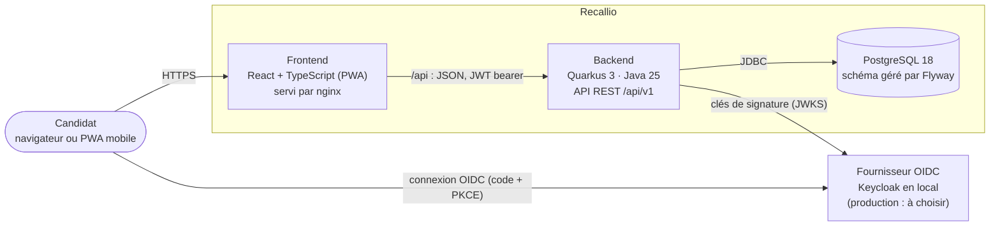
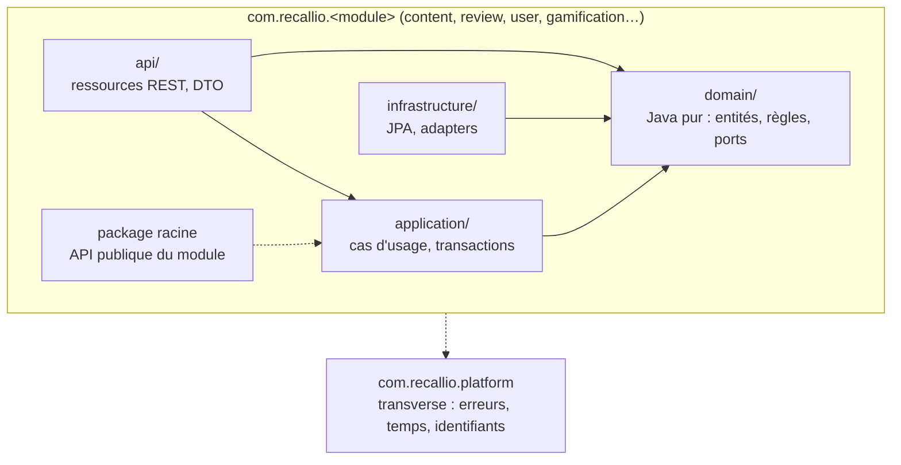
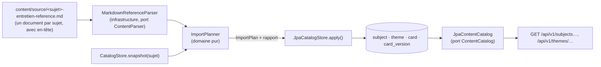
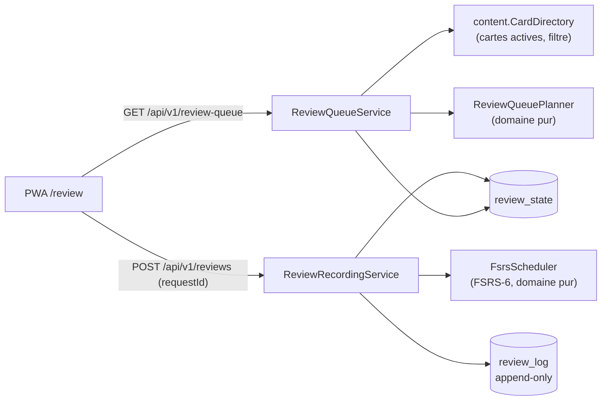
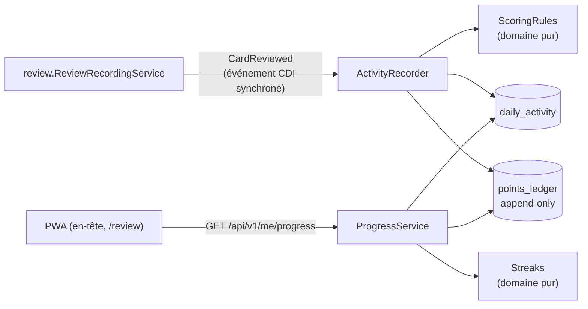
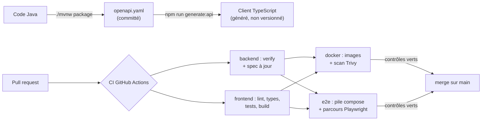

# Architecture de Recallio

> Document vivant, mis à jour à chaque étape. État : **phase 1, étape 2** (authentification OIDC et profil).
> Les décisions qui expliquent ces choix sont dans [docs/adr/](adr/).

## 1. Vue conteneurs (C4, niveau 2)

| Conteneur | Rôle | Technologies |
|---|---|---|
| Frontend | Interface de révision, installable sur mobile. Appelle l'API via un client **généré** depuis la spec OpenAPI. | React 19, Vite, TanStack Query, React Router, Tailwind, vite-plugin-pwa |
| Backend | Règles métier, API REST versionnée, validation des JWT. | Quarkus REST, Hibernate ORM, Hibernate Validator, SmallRye Health et OpenAPI |
| PostgreSQL | Données métier et progression. Le schéma est versionné par des migrations Flyway, jamais généré. | PostgreSQL 18 |
| Fournisseur OIDC | Authentification. Le backend ne connaît que le standard OIDC, pas le fournisseur. | Keycloak (local et Dev Services) |

En local avec Docker (`infra/compose.yaml`), nginx relaie `/api` vers le backend : le front et
l'API partagent la même origine, donc pas de CORS.

## 2. Vue composants du backend (C4, niveau 3)

Le backend est un **monolithe modulaire** (ADR 0001) : un module métier par package, découpé en
couches. Les règles ci-dessous sont **vérifiées à chaque build** par
[`ArchitectureTest`](../backend/src/test/java/com/recallio/ArchitectureTest.java).

| Règle | Pourquoi |
|---|---|
| `domain` ne dépend d'aucun framework (Quarkus, JPA, Jackson…) | Le cœur métier se teste unitairement, sans démarrer l'application. |
| Les dépendances vont vers l'intérieur | Un changement technique (base, framework) ne touche pas les règles métier. |
| Un module n'utilise que le **package racine** des autres modules | Les frontières restent explicites, et un module reste extractible. |
| Pas de cycle entre modules | Évite le « plat de spaghettis » en grandissant. |
| `platform` est utilisable par tous | Évite de dupliquer le transverse dans chaque module. |

**Modules prévus** : `content`, `review`, `user` et `gamification` (phase 1), `group` (phase 2),
`live` (phase 3), `organization` (phase 4).

### Module `content` (en place)

| Élément | Rôle |
|---|---|
| `domain.CardContent` | Interface `sealed` : `Flashcard`, `CodeOutput`, `OpenScenario`, `Definition`. |
| `domain.Subject` | Un sujet du catalogue : slug définitif, catégorie, ordre, brouillon ou publié (ADR 0013). |
| `domain.CardIdentity` | Identifiants stables (UUID v8) dérivés du sujet, du chapitre et de la question (ADR 0009 et 0013). |
| `infrastructure.markdown.SubjectHeader` | Lit l'en-tête `---` d'un document : le sujet qu'il décrit. |
| `domain.importing.ImportPlanner` | Compare un document à son sujet en base : ajouts, nouvelles versions, retraits (dans ce sujet seulement), réactivations. |
| `application.ContentImportService` | Transaction d'import et journalisation du rapport. |
| `api.SubjectsResource`, `api.ThemesResource` | Catalogue public (brouillons visibles des seuls admins), pagination bornée (100 cartes maximum par page). |
| `api.ContentImportResource` | Import d'un document à la demande, rôle `admin`. |
| `infrastructure.ContentStartupImport` | En dev et dans le compose : importe tous les documents du dossier, un sujet par transaction. |
| `CardDirectory` (package racine) | **API publique** pour les autres modules : cartes actives filtrées (sujets, thème, format) ou par thème, version courante. |
| `SubjectDirectory` (package racine) | **API publique** : les sujets publiés, dans l'ordre du catalogue. |
| `CardType` (package racine) | Formats de carte, partagés avec les autres modules. |

### Module `user` (en place)

| Élément | Rôle |
|---|---|
| `domain.UserProfile` | Profil applicatif : `sub` OIDC, nom affiché, fuseau horaire. |
| `application.UserProfileService` | Création à la première connexion, préférences. |
| `infrastructure.JpaUserProfileRepository` | Création atomique (`ON CONFLICT DO NOTHING`). |
| `api.TokenIdentity` | Seul endroit qui lit les claims du jeton (`sub`, `name`, `preferred_username`). |
| `application.FollowedSubjectsService` | Sujets suivis (ADR 0014) : choix validé auprès de `content.SubjectDirectory`. |
| `api.MeResource` | `GET` et `PUT /api/v1/me`, `PUT /api/v1/me/followed-subjects`, réservés à l'utilisateur connecté. |
| `CurrentUser` (package racine) | **API publique** : l'utilisateur de la requête (`UserRef` : identifiant, fuseau). |
| `FollowedSubjects` (package racine) | **API publique** : les sujets suivis par un utilisateur, qui alimentent ses révisions. |

Le flux complet est décrit dans l'ADR 0010 : la PWA obtient un jeton par Authorization Code + PKCE, et le backend
vérifie sa signature, son émetteur, son expiration et son audience (`recallio-api`).

### Module `review` (en place)

| Élément | Rôle |
|---|---|
| `domain.fsrs.FsrsScheduler` | FSRS-6 sans aléa : étapes d'apprentissage, intervalles en jours, oublis (ADR 0011). |
| `domain.queue.ReviewQueuePlanner` | Cartes dues (les plus en retard d'abord), puis nouvelles dans le quota du jour, en alternant les sujets (ADR 0014). |
| `application.ReviewQueueService` | File de révision, quota de nouvelles cartes remis à zéro à minuit dans le fuseau de l'utilisateur. |
| `application.ReviewRecordingService` | Réponse idempotente : verrou sur l'état, puis `requestId` unique dans le journal. |
| `infrastructure.*Entity` | Entités JPA séparées du domaine (domaine riche, CLAUDE.md section 4.3). |
| `api.ReviewsResource` | `GET /api/v1/review-queue` et `POST /api/v1/reviews` (201, ou 200 si rejouée). |
| `application.NewCardQuota` | Quota quotidien de nouvelles cartes, partagé par la file et les statistiques. |
| `domain.stats.CardCounts` | Cartes vues, maîtrisées (stabilité ≥ 21 jours, seuil « mature » d'Anki), dues maintenant et aujourd'hui. |
| `api.ReviewStatsResource` | `GET /api/v1/me/review-stats` : totaux et progression par thème (tableau de bord). |

Le module `review` ne lit aucune table des autres modules : il passe par `content.CardDirectory`,
`content.SubjectDirectory`, `user.CurrentUser` et `user.FollowedSubjects`, et ses tables n'ont pas de clé étrangère vers celles des autres modules.

Il publie l'événement `review.CardReviewed` (package racine, API publique) quand une réponse est enregistrée pour la
première fois.

### Module `gamification` (en place)

| Élément | Rôle |
|---|---|
| `domain.ScoringRules` | Barème : mêmes points pour chaque révision, bonus une fois par jour à l'objectif atteint. |
| `domain.Streaks` | Jours consécutifs avec l'objectif atteint ; un jour manqué remet à zéro. |
| `application.ActivityRecorder` | Observe `CardReviewed` dans la transaction de la révision (ADR 0012). |
| `application.ProgressService` | Points, streak et objectif du jour, dans le fuseau de l'utilisateur. |
| `api.ProgressResource` | `GET /api/v1/me/progress`, et `/activity` : cartes révisées chacun des derniers jours. |

Le tableau de bord de la PWA (accueil, une fois connecté) assemble trois lectures indépendantes :
`/api/v1/me/review-stats` (review), `/api/v1/me/progress` et `/api/v1/me/progress/activity` (gamification). Aucun
module « tableau de bord » côté serveur : chaque module expose ce qu'il sait.

Les dépendances entre modules vont dans un seul sens : `gamification` → `review` (événement) → `content`, `user`.

Le module transverse `platform` fournit les identifiants (`IdGenerator`, UUID v7), l'horloge (`Clock`),
la pagination (`Page`) et la traduction des erreurs en Problem Details (RFC 9457).

## 3. Flux de développement et de livraison

- **Contrat d'API** : code-first (ADR 0003). Toute évolution de l'API apparaît dans le diff de
  `openapi.yaml`, et la CI échoue si le fichier committé n'est plus à jour.
- **Qualité** : Error Prone et NullAway (ADR 0004), Spotless, ArchUnit côté backend ; ESLint,
  Prettier et le typage strict côté front.
- **Parcours de bout en bout** : Playwright joue la connexion, une session de révision (aussi sur mobile) et le
  streak contre la pile compose complète, avec une base neuve (`e2e/`, `infra/compose.e2e.yaml`).
- **Sécurité de la chaîne** : `main` est protégée (PR obligatoire, 3 contrôles requis), Dependabot
  suit les dépendances, les actions tierces sont fixées par SHA, et les images sont scannées.

## 4. Configuration par environnement

| Élément | Dev et tests | Production |
|---|---|---|
| PostgreSQL | Dev Services (conteneur automatique) | `DB_URL`, `DB_USERNAME`, `DB_PASSWORD` |
| OIDC | Dev Services Keycloak | `OIDC_AUTH_SERVER_URL`, `OIDC_CLIENT_ID` |
| `/q/*` (Dev UI, Swagger) | public | non exposé |
| Santé | `/api/v1/health` (public) | `/api/v1/health` (public) |

Les secrets passent uniquement par des variables d'environnement, jamais par le dépôt.
