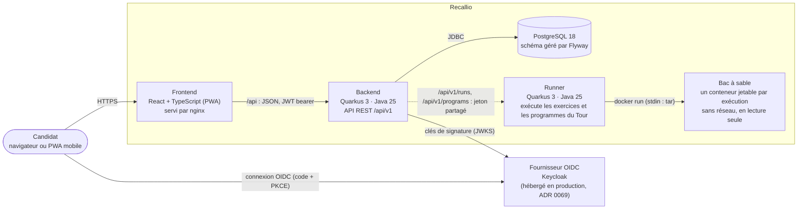
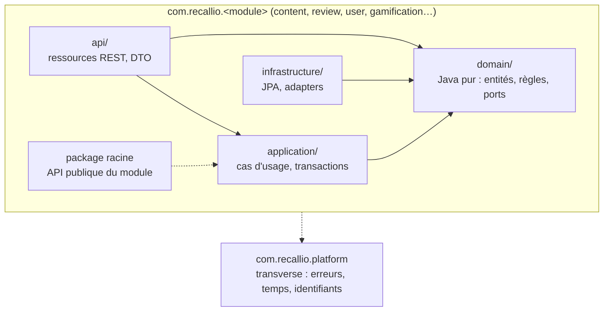
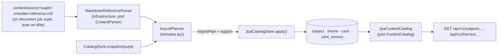
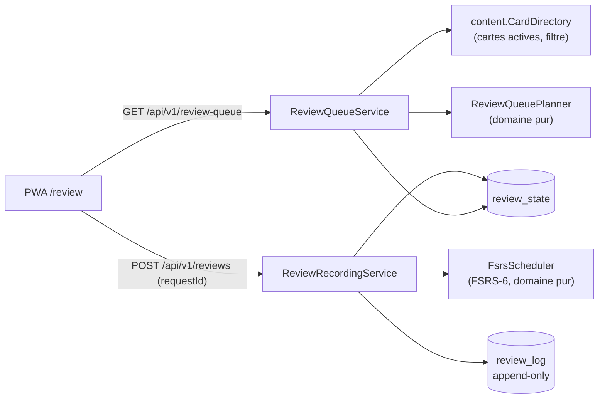
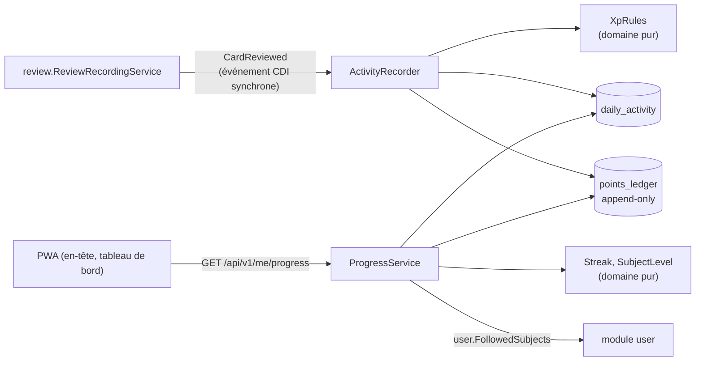
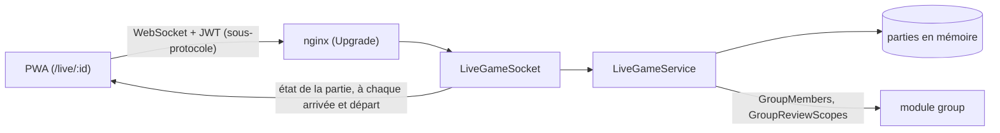
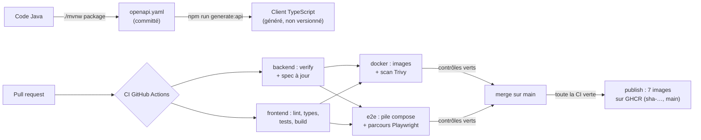
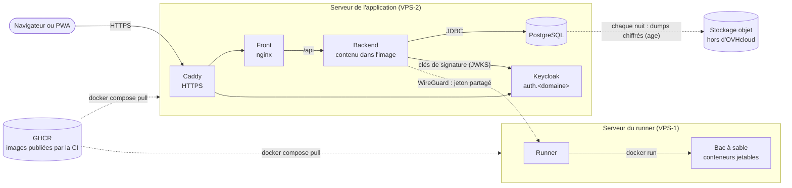

# Architecture de Recallio

> Document vivant, mis à jour à chaque étape. État : **phase 1, étape 2** (authentification OIDC et profil).
> Les décisions qui expliquent ces choix sont dans [docs/adr/](adr/).

## 1. Vue conteneurs (C4, niveau 2)

| Conteneur | Rôle | Technologies |
|---|---|---|
| Frontend | Interface de révision, installable sur mobile. Appelle l'API via un client **généré** depuis la spec OpenAPI. Son design system « Coach » (ADR 0049) ne passe que par des tokens, clairs et sombres. | React 19, Vite, TanStack Query, React Router, Tailwind, vite-plugin-pwa, CodeMirror 6 (exercices de code), Phosphor (icônes), Lexend et JetBrains Mono (servies par l'application) |
| Backend | Règles métier, API REST versionnée, validation des JWT. | Quarkus REST, Hibernate ORM, Hibernate Validator, SmallRye Health et OpenAPI |
| PostgreSQL | Données métier et progression. Le schéma est versionné par des migrations Flyway, jamais généré. | PostgreSQL 18 |
| Fournisseur OIDC | Authentification. Le backend ne connaît que le standard OIDC, pas le fournisseur. | Keycloak (local, Dev Services, et hébergé en production : ADR 0069) |
| Runner | Juge un exercice par ses tests (`/api/v1/runs`, ADR 0030) ou lance un programme du Tour et renvoie ses sorties (`/api/v1/programs`, ADR 0037). Seul à accéder au socket Docker ; joint par le seul backend. | Quarkus REST, ligne de commande `docker`, commons-compress |
| Bac à sable | Un conteneur neuf par exécution : réseau coupé, système de fichiers en lecture seule, ressources plafonnées, utilisateur sans droits, délai. | Images `sandbox/java` (JDK 25, JUnit 6), `sandbox/go` (Go 1.27, ADR 0033), `sandbox/cpp` (GCC 14, C++23, doctest, ADR 0053) et `sandbox/python` (Python 3.14, pytest, ADR 0062) |

En local avec Docker (`infra/compose.yaml`), nginx relaie `/api` vers le backend : le front et
l'API partagent la même origine, donc pas de CORS.

nginx porte aussi la sécurité de l'entrée (ADR 0054) : les en-têtes de sécurité, dont une Content-Security-Policy qui
n'admet que l'application, le fournisseur OIDC et Sentry (ADR 0070), et une limite de débit par adresse IP pour les
requêtes sans jeton (essai, catalogue) et pour les invitations.

Pour le référencement (ADR 0065), nginx met l'origine publique du site (`PUBLIC_ORIGIN`) dans les balises de partage
d'`index.html` et dans `robots.txt`, là seulement où il sert les fichiers, et relaie `/sitemap.xml` vers le plan du
site que produit le backend.

## 2. Vue composants du backend (C4, niveau 3)

Le backend est un **monolithe modulaire** (ADR 0001) : un module métier par package, découpé en
couches. Les règles ci-dessous sont **vérifiées à chaque build** par
[`ArchitectureTest`](../backend/src/test/java/com/recallio/ArchitectureTest.java).

| Règle | Pourquoi |
|---|---|
| `domain` ne dépend d'aucun framework (Quarkus, JPA, Jackson…) | Le cœur métier se teste unitairement, sans démarrer l'application. |
| Les dépendances vont vers l'intérieur | Un changement technique (base, framework) ne touche pas les règles métier. |
| Un module n'utilise que le **package racine** des autres modules | Les frontières restent explicites, et un module reste extractible. |
| Pas de cycle entre modules | Évite le « plat de spaghettis » en grandissant. |
| `platform` est utilisable par tous | Évite de dupliquer le transverse dans chaque module. |

**Modules prévus** : `content`, `review`, `user` et `gamification` (phase 1), `group` (phase 2),
`live` (phase 3), `feedback`, `ranked` et `notification` (phase 3 ter), `organization` (phase 4).

### Module `content` (en place)

| Élément | Rôle |
|---|---|
| `domain.CardContent` | Interface `sealed` : `Flashcard`, `CodeOutput`, `OpenScenario`, `Definition`, `MultipleChoice` (ses choix, ADR 0019). |
| `domain.Subject` | Un sujet du catalogue : slug définitif, catégorie, ordre, brouillon ou publié (ADR 0013). |
| `domain.CardIdentity` | Identifiants stables (UUID v8) dérivés du sujet, du chapitre et de la question (ADR 0009 et 0013). |
| `infrastructure.markdown.SubjectHeader` | Lit l'en-tête `---` d'un document : le sujet qu'il décrit. |
| `domain.importing.ImportPlanner` | Compare un document à son sujet en base : ajouts, nouvelles versions, retraits (dans ce sujet seulement), réactivations. |
| `application.ContentImportService` | Transaction d'import et journalisation du rapport. |
| `api.SubjectsResource`, `api.ThemesResource` | Catalogue public (contenu des brouillons visible des seuls admins), pagination bornée (100 cartes maximum par page). Chaque sujet dit s'il a un Tour (`hasTour`), et donc un essai sans compte (ADR 0050). `?upcoming=true` annonce aussi les brouillons, pour les pages Cours, Tour et Révisions ; `GET /api/v1/subjects/{s}/notions/{n}` sert la leçon d'une notion et ses voisines (ADR 0052). |
| `api.TourResource` | Le Tour d'un sujet, public comme le catalogue (ADR 0037) : `GET /api/v1/subjects/{s}/tour`, le sommaire par domaine et chapitre sans le contenu des pages, puis `/tour/{notion}`, les pages d'une notion. La solution et la sortie attendue d'un « À toi » restent sur le serveur. |
| `TourDirectory` (package racine), `infrastructure.persistence.JpaTourDirectory` | **API publique** : une page du Tour, « À toi » compris, pour que le module `review` le juge sans que sa sortie attendue ne quitte le backend. |
| `TourPage` (package racine) | Une page du Tour et ses règles : un programme d'un seul langage, `Main.java` en Java, un « À toi » aux fichiers de son code de départ (ADR 0037). |
| `domain.TourQuestions` | Les questions qui valident une notion du Tour : ses cartes corrigées par le serveur, une par format d'abord, trois au plus, dans l'ordre du fichier. Le parseur en exige deux (ADR 0037). |
| `application.SitemapService`, `api.SitemapResource` | Le plan du site (ADR 0065), `GET /api/v1/sitemap.xml` sans compte, que nginx sert sous `/sitemap.xml` : l'accueil, les pages Cours et Tour, le catalogue, puis la page, les leçons et le Tour de chaque sujet publié, en adresses absolues à l'origine `recallio.public-origin`. |
| `api.ContentImportResource` | Import d'un document à la demande, rôle `admin`. |
| `infrastructure.ContentStartupImport` | En dev, et dans l'image du backend, qui emporte `content/` (ADR 0069) : importe à chaque démarrage tous les documents de référence et tous les dossiers de sujet, un sujet par transaction. |
| `CardDirectory` (package racine) | **API publique** pour les autres modules : cartes actives filtrées (sujets, thème, format) ou par thème, version courante, notions d'un sujet ou une seule, questions qui valident une notion du Tour. |
| `SubjectDirectory` (package racine) | **API publique** : les sujets publiés, dans l'ordre du catalogue. |
| `CardType`, `CardChoice` (package racine) | Formats de carte et choix d'un QCM, partagés avec les autres modules. |

### Module `user` (en place)

| Élément | Rôle |
|---|---|
| `domain.UserProfile` | Profil applicatif : `sub` OIDC, nom affiché, fuseau horaire. |
| `application.UserProfileService` | Création à la première connexion, préférences ; publie `AccountCreated` (package racine, ADR 0064) quand il crée le profil. |
| `infrastructure.JpaUserProfileRepository` | Création atomique (`ON CONFLICT DO NOTHING`). |
| `api.TokenIdentity` | Seul endroit qui lit les claims du jeton (`sub`, `name`, `preferred_username`). |
| `application.FollowedSubjectsService` | Sujets suivis (ADR 0014) : choix validé auprès de `content.SubjectDirectory`. |
| `api.MeResource` | `GET` et `PUT /api/v1/me`, `PUT /api/v1/me/followed-subjects`, réservés à l'utilisateur connecté. |
| `CurrentUser` (package racine) | **API publique** : l'utilisateur de la requête (`UserRef` : identifiant, fuseau). |
| `FollowedSubjects` (package racine) | **API publique** : les sujets suivis par un utilisateur, qui alimentent ses révisions. |
| `application.PublicProfileService`, `api.PublicProfileSettingsResource` | L'adresse et la visibilité du profil public (ADR 0043), privé par défaut : `GET` et `PUT /api/v1/me/public-profile`, table `public_profile`. |
| `PublicProfiles` (package racine) | **API publique** : un profil public par son adresse ; un profil privé ou inconnu est absent. |

Le flux complet est décrit dans l'ADR 0010 : la PWA obtient un jeton par Authorization Code + PKCE, et le backend
vérifie sa signature, son émetteur, son expiration et son audience (`recallio-api`).

### Module `review` (en place)

| Élément | Rôle |
|---|---|
| `domain.fsrs.FsrsScheduler` | FSRS-6 sans aléa : étapes d'apprentissage, intervalles en jours, oublis (ADR 0011). |
| `domain.queue.ReviewQueuePlanner` | Cartes dues (les plus en retard d'abord), puis nouvelles dans le quota du jour de chaque sujet (ADR 0048), en alternant les sujets quand la file en réunit plusieurs. |
| `application.ReviewQueueService` | File de révision, filtrée par sujet, thème, groupe ou formats ; quota de nouvelles cartes par sujet (`NewCardQuota`), remis à zéro à minuit dans le fuseau de l'utilisateur. |
| `application.ReviewRecordingService` | Réponse idempotente : verrou sur l'état, puis `requestId` unique dans le journal. Corrige un QCM et en déduit la note (ADR 0019). |
| `infrastructure.*Entity` | Entités JPA séparées du domaine (domaine riche, CLAUDE.md section 4.3). |
| `api.ReviewsResource` | `GET /api/v1/review-queue` et `POST /api/v1/reviews` (201, ou 200 si rejouée). |
| `application.NewCardQuota` | Quota quotidien de nouvelles cartes, partagé par la file et les statistiques. |
| `domain.stats.CardCounts` | Cartes vues, maîtrisées (stabilité ≥ 21 jours, seuil « mature » d'Anki), dues maintenant et aujourd'hui. |
| `api.ReviewStatsResource` | `GET /api/v1/me/review-stats` : totaux, puis progression par sujet suivi et par thème (tableau de bord), avec la maîtrise des notions et l'indice de préparation de chaque sujet. |
| `SkillProfiles` (package racine), `application.SkillProfileService` | **API publique** : les compétences d'un utilisateur par sujet, le vérifié (exercices réussis, réponses corrigées, notions du Tour) séparé du déclaré (maîtrise, préparation), pour le profil public (ADR 0043). |
| `application.MockExamService`, `api.MockExamsResource`, `domain.exam.MockExamDraw` | L'examen blanc (ADR 0044) : `POST /api/v1/me/mock-exams`, une question par notion à chaque tour, les essentielles d'abord ; une minute par question, mesurée par le serveur ; `POST …/{id}/submission`, la note et le corrigé. Tables `mock_exam` et `mock_exam_question` ; ni le journal, ni FSRS, ni l'XP ne voient les réponses. |
| `domain.track.Readiness` | L'indice de préparation d'un sujet (ADR 0041) : ses notions essentielles acquises comptent pour moitié, maîtrisées en entier ; prêt à partir de 80 %. |
| `application.InterviewService`, `api.InterviewsResource`, `domain.interview.InterviewCountdown` | Le compte à rebours avant l'entretien (ADR 0066), une date par sujet suivi (table `interview_plan` : la date, le jour où elle a été fixée, la ligne de départ). `GET /api/v1/me/interviews` : pour chaque sujet suivi qui a une date, les jours qui restent, l'avance ou le retard, les notions essentielles de la semaine et les semaines suivantes, recalculés d'après la maîtrise ; `PUT …/{s}` fixe ou change la date (le plan repart d'aujourd'hui), `DELETE …/{s}` la retire. |
| `application.DailyChallengeService`, `api.DailyChallengesResource`, `domain.daily.DailyChallengeDraw` | Le défi du jour (ADR 0067) : par sujet publié et par jour (celui de chaque joueur, dans son fuseau), cinq questions de difficulté croissante, tirées à la première demande puis gardées (tables `daily_challenge` et `daily_challenge_question`), sans les cartes des 30 derniers défis du sujet. `GET /api/v1/me/daily-challenges` : l'état de chaque sujet, sans rien tirer ; `GET …/{s}` : le défi du jour, ou celui de la veille s'il est à finir ; `POST …/{id}/answers` : une réponse par question, idempotente, corrigée tout de suite (table `daily_challenge_answer`, le verdict seul), puis le score et les chiffres du jour, agrégés. Ni le journal, ni FSRS, ni l'XP ne voient les réponses. |
| `application.ExerciseRunService`, `application.PlaygroundRunService` | Exécuter un exercice contre ses tests (ADR 0030), ou un programme du Tour (`POST /api/v1/playground-runs`, ADR 0037). Rien n'est enregistré. |
| `application.RunLock` | Une exécution à la fois par utilisateur, exercices et programmes confondus : 429 sinon. |
| `infrastructure.runner.HttpCodeRunner`, `HttpProgramRunner` | Les deux modes du runner, derrière les ports `CodeRunner` et `ProgramRunner` ; une panne du runner répond 503. |
| `application.PracticeService`, `api.PracticeResource`, `domain.practice.PracticeOrder` | S'entraîner sur une notion (ADR 0038) : `GET /api/v1/me/practice/{s}/{notion}`, toutes ses cartes, formats alternés, exercices à la fin ; `POST …/checks`, la correction d'un vrai ou faux, d'un QCM ou d'un code à trous. Rien n'est enregistré. |
| `application.TourTaskService` | Juger un « À toi » (`POST /api/v1/me/tour/{s}/{notion}/tasks`) : le programme passe par le runner, une exécution à la fois par utilisateur, et sa sortie est comparée à celle attendue comme le fait la CI (fins de ligne, blancs finaux). Rien n'est enregistré. |
| `application.AnswerCorrection` | La correction sans enregistrement, partagée par le Tour et l'entraînement. |
| `application.TrialService`, `api.TrialResource` | L'essai sans compte (ADR 0050), public comme le catalogue : `GET /api/v1/subjects/{s}/trial`, cinq questions, une par notion essentielle, dans des formats corrigés par le serveur ; `POST …/trial/{notion}/checks`, la correction de l'entraînement. Rien n'est enregistré. |
| `application.LevelCheckService`, `api.LevelChecksResource`, `domain.level.LevelCheckDomain` | Le test de niveau (ADR 0068) : deux questions par domaine des bases, de notions débutantes différentes, corrigées sans exécuter de code. `GET /api/v1/me/level-checks/{s}` : le test, tiré à chaque appel, sans les réponses ; `POST …/{s}/domains/{domaine}` : la correction d'un domaine, sans session gardée ; toutes justes, ses notions débutantes deviennent connues (table `known_notion`) ; `DELETE …/{s}` annule le test. Une notion connue n'attend plus le Tour, ouvre celles qui la requièrent (`LearningPath`) et passe après les autres en révision (`NewCardOrder`) ; elle n'est pas acquise. Ni le journal, ni FSRS, ni l'XP ne voient ces réponses. |
| `application.TourProgressService`, `api.TourProgressResource` | La progression dans le Tour (ADR 0037). `GET /api/v1/me/tour/{s}` : les notions validées et celles connues au test de niveau, et la dernière page ouverte (`PUT /api/v1/me/tour/{s}/last-page`, table `tour_last_page`), oubliée si elle sort du Tour. `GET /api/v1/me/tour/{s}/{notion}` : ses questions sans leurs réponses ; `POST /api/v1/me/tour/{s}/{notion}/checks` : la correction. Toutes justes, la notion est validée (table `tour_progress`) et le reste. Ni le journal, ni FSRS, ni l'XP ne voient ces réponses. |

Le module `review` ne lit aucune table des autres modules : il passe par `content.CardDirectory`,
`content.SubjectDirectory`, `user.CurrentUser` et `user.FollowedSubjects`, et ses tables n'ont pas de clé étrangère vers celles des autres modules.

Il publie l'événement `review.CardReviewed` (package racine, API publique) quand une réponse est enregistrée pour la
première fois, et `review.TrialStarted` quand un visiteur répond à la première question d'un essai (ADR 0064).

### Module `gamification` (en place)

| Élément | Rôle |
|---|---|
| `domain.XpRules` | Barème de l'XP (ADR 0035) : une base à chaque révision selon l'effort du format (`Effort`), un bonus pour une réussite corrigée par le serveur, celui de l'objectif du jour une fois par jour. |
| `domain.SubjectLevel` | Le niveau d'un sujet d'après son XP : passer du niveau n au niveau n + 1 demande 100 × n XP. |
| `domain.Streak` | Jours consécutifs avec l'objectif atteint et gels de streak (ADR 0036) : un gel tous les 7 jours, 2 au plus ; un jour manqué consomme un gel, sinon remet à zéro. Recalculé à chaque lecture, rien n'est stocké. |
| `domain.XpLedger` | Le registre append-only de l'XP, dans la table `points_ledger` ; chaque entrée garde le sujet de la carte révisée. |
| `application.ActivityRecorder` | Observe `CardReviewed` (sujet, format, réussite) dans la transaction de la révision (ADR 0012). |
| `application.ProgressService` | XP et niveau de chaque sujet suivi, streak et objectif du jour, dans le fuseau de l'utilisateur. |
| `api.ProgressResource` | `GET /api/v1/me/progress`, et `/activity` : cartes révisées chacun des derniers jours. |
| `domain.leaderboard.WeeklyRanking` | Le rang de la semaine : jours réguliers, puis XP, puis cartes ; ex æquo au même rang (ADR 0018). |
| `application.GroupLeaderboardService` | Le classement d'un groupe : membres et réglages par `group.GroupLeaderboards`, activité par `WeeklyActivity`. |
| `api.LeaderboardResource` | `GET /api/v1/groups/{id}/leaderboard`, rangé sous le groupe mais servi par ce module. |
| `domain.quest.Quest`, `QuestBoard` | Le catalogue des quêtes et le choix de la période : trois par jour, deux par semaine, calculés depuis l'utilisateur et la période, rien n'est tiré ni planifié (ADR 0040). |
| `application.QuestTracker` | Observe `CardReviewed`, `TourPageOpened` et `TourNotionValidated` dans leur transaction ; une quête terminée écrit son XP (`QUEST`) une fois et publie `QuestCompleted`. |
| `application.AchievementTracker` | Débloque les succès au fil des mêmes événements et de `QuestCompleted` ; table `achievement`, une ligne par succès, jamais retirée. |
| `api.QuestsResource`, `api.AchievementsResource` | `GET /api/v1/me/quests` et `GET /api/v1/me/achievements`. |
| `application.PublicSkillProfileService`, `api.PublicProfilesResource` | Le profil public (ADR 0043), `GET /api/v1/public-profiles/{adresse}` sans compte : `user.PublicProfiles`, le vérifié et le déclaré par `review.SkillProfiles`, puis le niveau, la série et les succès. |
| `domain.RetentionReport`, `application.RetentionService`, `api.AdminRetentionResource` | La rétention (ADR 0050), `GET /api/v1/admin/retention`, rôle admin : la part des joueurs revenus réviser 1, 7 et 30 jours après leur premier jour actif, calculée sur `daily_activity`. |
| `application.FunnelRecorder`, `api.FunnelVisitsResource` | Le parcours mesuré (ADR 0064) : la visite (`POST /api/v1/funnel/visits`, sans compte), l'essai (`review.TrialStarted`), le compte (`user.AccountCreated`) et la première révision (`CardReviewed`, après `ActivityRecorder`), dans la table `funnel_event`, sans identifiant d'utilisateur. |
| `domain.funnel.FunnelReport`, `application.FunnelService`, `api.AdminFunnelResource` | `GET /api/v1/admin/funnel`, rôle admin : chaque étape des huit dernières semaines ISO (en UTC), et le taux de passage de l'une à la suivante. |
| `domain.beta.BetaReport`, `application.BetaReportService`, `api.AdminBetaResource` | La page « Bêta » des admins (ADR 0076), `GET /api/v1/admin/beta`, rôle admin : sur trente jours, l'activité par jour, les sujets, les cartes les plus ratées et les plus signalées, le Tour et l'usage de chaque fonctionnalité. Le service ne lit aucune table : il rassemble les réponses des `UsageStatistics` de chaque module (`platform`), et nomme le contenu par `content.CardDirectory` et `content.SubjectDirectory`. |

Le tableau de bord de la PWA (accueil, une fois connecté) assemble des lectures indépendantes :
`/api/v1/subjects` (content, pour les titres et les Tours), `/api/v1/me/review-stats`, `/api/v1/me/interviews` et
`/api/v1/me/daily-challenges` (review), `/api/v1/me/progress`,
`/api/v1/me/progress/activity` et `/api/v1/me/quests` (gamification). Aucun
module « tableau de bord » côté serveur : chaque module expose ce qu'il sait.

### Module `group` (en place)

| Élément | Rôle |
|---|---|
| `domain.StudyGroup` | Un groupe et ses membres : un créateur unique, qui seul gère les membres et supprime le groupe (ADR 0015) ; 100 membres au plus. |
| `domain.GroupSettings` | Les réglages : sujets, thèmes, formats, objectif quotidien, visibilité du classement (ADR 0017). |
| `domain.Challenge`, `domain.ChallengeRun` | Un défi (série de QCM, délai par carte, ouvert sept jours) et la partie d'un membre (ADR 0020). |
| `domain.GroupInvitation` | Le lien d'invitation d'un groupe : un jeton aléatoire (`InvitationToken`), valable 7 jours (ADR 0016). |
| `application.GroupAccess` | Le contrôle d'accès commun : groupe visible d'un membre (sinon 404), géré par son créateur (sinon 403). |
| `application.StudyGroupService` | Cas d'usage des groupes et de leurs membres. |
| `application.GroupSettingsService` | Le créateur modifie les réglages ; implémente `group.GroupReviewScopes`, lu par le module review. |
| `application.ChallengeService`, `application.ChallengePlayService` | Lancer un défi et le classer ; le jouer carte par carte, chrono mesuré par le serveur. |
| `application.GroupInvitationService` | Générer, remplacer, désactiver le lien ; le consulter puis rejoindre le groupe. |
| `infrastructure.JpaStudyGroupRepository` | Tables `study_group` et `group_member`, sans clé étrangère vers `app_user`. |
| `infrastructure.JpaGroupSettingsRepository` | Table `group_settings`, avec des tableaux `text[]` ; pas de ligne : réglages par défaut. |
| `infrastructure.JpaGroupInvitationRepository` | Table `group_invitation` : un lien par groupe au plus. |
| `api.GroupsResource` | `/api/v1/groups` : mes groupes, création, détail, quitter, retirer un membre, supprimer, réglages, lien d'invitation. |
| `api.GroupChallengesResource`, `api.ChallengesResource` | `/api/v1/groups/{id}/challenges`, puis `/api/v1/challenges/{id}` (`/next`, `/answers`). |
| `api.InvitationsResource` | `/api/v1/invitations/{token}` : le groupe auquel invite un lien, et le rejoindre. |

Il obtient les noms des membres par `user.UserDirectory` (API publique du module `user`) et les thèmes d'un sujet par
`content.SubjectDirectory`. Le module `review` lit le périmètre d'un groupe par `group.GroupReviewScopes`
(`/api/v1/review-queue?group=...`).

### Module `live` (en place, phase 3)

| Élément | Rôle |
|---|---|
| `domain.LiveGame` | Une partie en cours, en mémoire : hôte, sujet, joueurs et leurs connexions (50 au plus, ADR 0021) ; machine à états `LOBBY` → (`QUESTION` → `REVEAL`) × N → `FINISHED`, pilotée par l'instant reçu (ADR 0022). |
| `domain.LiveGameRepository` | Les parties ouvertes, une au plus par groupe ; `infrastructure.InMemoryLiveGameRepository` les garde en mémoire. |
| `application.LiveGameService` | Ouvrir, rejoindre, quitter, démarrer, répondre ; appartenance vérifiée par `group.GroupMembers`. Chaque changement est diffusé (`LiveGameEvents`) et programme le réveil de l'étape (`LiveScheduler`). |
| `application.LiveQuestionDraw` | Tire les QCM d'une partie, dans le sujet et les thèmes du groupe. |
| `domain.LiveScoring` | Le barème : 500 points pour une réponse juste, jusqu'à 500 de plus selon le temps restant (ADR 0023). |
| `infrastructure.JpaLiveResultRepository` | Tables `live_game` et `live_game_player` : le classement final de chaque partie, écrit hors de la boucle d'événements. |
| `infrastructure.VertxLiveScheduler` | Minuteurs Vert.x : réveillent une partie à l'échéance de son étape, sans bloquer de thread. |
| `api.GroupLiveGamesResource`, `api.LiveGamesResource` | `/api/v1/groups/{id}/live-games`, `/api/v1/live-games/{id}` ; les commandes `/start` et `/answers` passent en REST. |
| `api.LiveGameBroadcaster` | Implémente `LiveGameEvents` : l'état de la partie, temps restant compris, à toutes ses connexions ; jauge des connexions ouvertes. |
| `infrastructure.MicrometerLiveMetrics` | Les métriques du mode live (parties ouvertes, démarrées, finies, réponses), sur `/q/metrics` (ADR 0024). |
| `api.LiveGameSocket` | WebSocket `/api/v1/live/{id}`, authentifié par le JWT porté dans le sous-protocole ; diffuse l'état de la partie. |

### Module `feedback` (en place, phase 3 ter)

| Élément | Rôle |
|---|---|
| `domain.ContentReport`, `ReportTarget` | Un signalement (ADR 0042) : une carte, ou une page d'une notion du Tour, une raison, des précisions ; ouvert jusqu'à ce qu'un admin le traite (corrigé ou rejeté). |
| `application.ContentReportService` | Vérifie le contenu signalé par `content.CardDirectory` (publié seulement), un signalement ouvert par contenu et par utilisateur, 20 ouverts au plus ; traite un signalement en une instruction. |
| `infrastructure.JpaContentReportRepository` | Table `content_report`, sans clé étrangère vers les autres modules. |
| `api.ContentReportsResource` | `POST /api/v1/content-reports`. |
| `api.AdminContentReportsResource` | `GET /api/v1/admin/content-reports` (ouverts ou traités, paginé) et `PUT …/{id}/resolution`, rôle admin ; l'auteur d'un signalement n'est pas montré. |

### Module `ranked` (en place, phase 3 ter)

| Élément | Rôle |
|---|---|
| `domain.glicko.Glicko2`, `Rating` | Glicko-2 (Glickman, 2012) en Java pur : une période de notation par duel, ou par réponse pour une carte (ADR 0046). Les cotes ne quittent pas le serveur. |
| `domain.Rank`, `Season`, `Standing` | Le rang d'une cote (Bronze à Maître, quatre divisions), la saison (un trimestre, remise à mi-chemin de 1500), la place d'un joueur dans un sujet : placement de 5 duels, meilleur rang de la saison. |
| `domain.Duel`, `DuelScore`, `DuelDraw`, `DuelGrading` | Un duel : deux joueurs, 5 questions tirées près de leur niveau, 30 secondes chacune ; le plus de bonnes réponses gagne, puis le temps ; la correction par les règles de la carte. |
| `application.CardDifficulty` | La cote de difficulté des cartes : observe `review.CardReviewed` (formats corrigés par le serveur) et les réponses des duels. |
| `application.DuelService`, `DuelResolution` | Chercher un duel (asynchrone : le sien, le plus proche en cote, ou un nouveau ; direct : une file, `ranked_queue`), servir une question une fois, corriger, régler : les expirations se règlent à la lecture. |
| `application.RankedViews`, `RankedProfiles` (package racine) | Les rangs, insignes et duels de l'utilisateur ; **API publique** : son rang par sujet, pour le profil public (ADR 0043). |
| `api.DuelsResource`, `api.MyRankedResource` | `POST /api/v1/ranked/duels`, `POST` et `DELETE /api/v1/ranked/live-queue`, `GET /api/v1/ranked/duels/{id}`, `POST …/next`, `POST …/answers` ; `GET /api/v1/me/ranked` et `/duels`. |

### Module `notification` (en place, phase 3 ter)

| Élément | Rôle |
|---|---|
| `domain.PushSubscription`, `Reminder` | Un abonnement Web Push par appareil, vers un service de notification connu (liste fermée, contre le SSRF) ; le rappel : un par jour au plus, à partir de l'heure choisie, le message selon la série (ADR 0047). |
| `application.ReminderPlanner`, `ReminderService` | Réserve en base les rappels dus (si l'objectif du jour, lu par `gamification.DailyGoals`, n'est pas atteint), puis les envoie hors transaction ; un appareil désabonné est oublié. |
| `infrastructure.push.WebPushEncryption`, `Vapid`, `HttpPushSender` | Le chiffrement aes128gcm de la RFC 8291, le jeton VAPID ES256 de la RFC 8292, l'envoi par le client HTTP du JDK ; clés VAPID en variables d'environnement. |
| `infrastructure.ReminderTimer` | Un minuteur Vert.x toutes les 10 minutes, désactivé en test. |
| `api.PushSubscriptionsResource`, `api.PushPublicKeyResource` | `PUT` et `DELETE /api/v1/me/push-subscription`, `GET /api/v1/push/public-key`. |

Les dépendances entre modules vont dans un seul sens : `gamification` → `review` (événement) → `content`, `user` ;
`gamification` → `user` (événement `AccountCreated`) ;
`review` → `group` → `content`, `user` ;
`gamification` → `group` (classement des groupes), `ranked` (le rang du profil public) ; `live` → `group`, `user` ;
`feedback` → `content`, `user` ; `ranked` → `content`, `user`, `review` (événement) ;
`notification` → `user`, `gamification`.

Le module transverse `platform` fournit les identifiants (`IdGenerator`, UUID v7), l'horloge (`Clock`),
la pagination (`Page`) et la traduction des erreurs en Problem Details (RFC 9457).

Il porte aussi deux ports que chaque module implémente dans son `infrastructure`, pour répondre de ses propres tables
sans qu'un autre module les lise :

| Port | Qui l'appelle | Pour quoi |
|---|---|---|
| `platform.domain.PersonalData` | `user.application.AccountService` | Exporter et effacer les données d'un compte (ADR 0056). |
| `platform.domain.UsageStatistics` | `gamification.application.BetaReportService` | Compter l'usage, en agrégé, pour la page « Bêta » des admins (ADR 0076) : des comptes par fonctionnalité, par jour, par sujet et par carte. Une question sans objet pour un module garde sa réponse vide. |

## 3. Flux de développement et de livraison

- **Contrat d'API** : code-first (ADR 0003). Toute évolution de l'API apparaît dans le diff de
  `openapi.yaml`, et la CI échoue si le fichier committé n'est plus à jour.
- **Qualité** : Error Prone et NullAway (ADR 0004), Spotless, ArchUnit côté backend ; ESLint,
  Prettier et le typage strict côté front.
- **Parcours de bout en bout** : Playwright joue la connexion, une session de révision (aussi sur mobile) et le
  streak contre la pile compose complète, avec une base neuve (`e2e/`, `infra/compose.e2e.yaml`).
- **Sécurité de la chaîne** : `main` est protégée (PR obligatoire, 3 contrôles requis), Dependabot
  suit les dépendances, les actions tierces sont fixées par SHA, et les images sont scannées.
- **Livraison** (ADR 0069) : sur `main`, une fois tous les jobs verts, le job `publish` construit les sept images
  (backend, front, runner, les quatre bacs à sable) et les publie sur GHCR, `ghcr.io/<propriétaire>/recallio-<image>`,
  aux tags `sha-<commit>` (immuable, celui que le serveur épingle) et `main`.

## 4. Configuration par environnement

| Élément | Dev et tests | Production |
|---|---|---|
| PostgreSQL | Dev Services (conteneur automatique) | `DB_URL`, `DB_USERNAME`, `DB_PASSWORD` |
| OIDC | Dev Services Keycloak | `OIDC_AUTH_SERVER_URL`, `OIDC_CLIENT_ID` |
| Fournisseur OIDC de la PWA (ADR 0069) | `VITE_OIDC_AUTHORITY`, ou le Keycloak local ; `OIDC_AUTHORITY` dans le compose | `OIDC_AUTHORITY` du front, que nginx met dans `index.html`, et son origine `OIDC_ORIGIN` (CSP, ADR 0054), que le compose de production déduit tous deux de `DOMAIN` (ADR 0071) |
| Keycloak (ADR 0071) | `start-dev`, le royaume local et ses comptes de test (`infra/keycloak/`), par les Dev Services ou le compose | `start`, le royaume de production, sans utilisateur (`infra/production/app/keycloak/`), importé au premier démarrage ; console par un tunnel SSH |
| HTTPS (ADR 0071) | aucun : `http://localhost` | Caddy : certificats Let's Encrypt, HSTS, et seuls les chemins du royaume `recallio` sous `auth.<domaine>` |
| Contenu (ADR 0069) | importé à chaque démarrage depuis `../content` en dev | dans l'image du backend (`/content`), importé à chaque démarrage |
| Rappels (Web Push, ADR 0047) | paire VAPID éphémère, tirée au démarrage ; aucun minuteur en test | `RECALLIO_PUSH_VAPID_PUBLIC_KEY`, `RECALLIO_PUSH_VAPID_PRIVATE_KEY`, `RECALLIO_PUSH_SUBJECT` |
| Origine publique du site (plan du site, balises de partage, `robots.txt` ; ADR 0065) | celle de Vite en dev, `https://recallio.test/` en test ; `http://localhost:3000` dans le compose | `PUBLIC_ORIGIN`, la même au backend (obligatoire) et au front (nginx), `https://<DOMAIN>` dans le compose de production |
| Pages légales (ADR 0074) | sans nginx (`npm run dev`), ni éditeur ni contact ; des valeurs d'exemple dans le compose | `LEGAL_CONTACT_EMAIL` (obligatoire) et `LEGAL_PUBLISHER` (facultatif) du front, que nginx échappe et met dans `index.html` : le dépôt, public, ne porte aucune coordonnée de l'éditeur |
| Logs (ADR 0070) | texte lisible en dev et en test ; JSON dans le compose, en profil `prod` | JSON sur la sortie standard, un champ `service` par ligne ; nginx sans adresse IP ni chaîne de requête |
| Erreurs dans Sentry (ADR 0070) | éteint : aucun DSN en dev, en test, en CI ni dans le compose | `SENTRY_DSN` de chaque service (backend, runner, front), `SENTRY_ENVIRONMENT` (`production` par défaut), `SENTRY_RELEASE` (le tag de l'image, mis par le compose de production) ; au front, l'origine du DSN dans `SENTRY_ORIGIN` (CSP) |
| `/q/*` (Dev UI, Swagger) | public | non exposé |
| Santé | `/api/v1/health` (public) | `/api/v1/health` (public) |

Les secrets passent uniquement par des variables d'environnement, jamais par le dépôt.

## 5. Déploiement (ADR 0069, 0071, 0072, 0073)

Deux VPS OVHcloud, en Docker Compose, reliés par WireGuard. Les serveurs ne construisent rien : ils tirent de GHCR les
images publiées par la CI, au tag `sha-…` qu'ils épinglent. La procédure, du serveur nu à la mise à jour, est dans
[docs/deploiement.md](deploiement.md).

| Serveur | Ce qu'il porte | Qui lui parle |
|---|---|---|
| L'application (VPS-2 : 4 vCores, 8 Go) | Caddy (HTTPS), le front, le backend, Keycloak sous son propre sous-domaine, PostgreSQL | Les navigateurs, par Caddy : l'application d'un côté, Keycloak de l'autre, chacun à son origine |
| Le runner (VPS-1 : 2 vCores, 4 Go) | Le runner et les images du bac à sable, rien d'autre : son accès au socket Docker vaut les droits root sur l'hôte (ADR 0030) | Le seul backend, par le tunnel WireGuard, avec le jeton partagé |

- **Une seule image par composant, pour tous les environnements** : le backend emporte le contenu et l'importe à chaque
  démarrage ; le front reçoit à son démarrage l'adresse du fournisseur OIDC (`OIDC_AUTHORITY`), son origine
  (`OIDC_ORIGIN`), l'origine publique du site (`PUBLIC_ORIGIN`) et les coordonnées de l'éditeur, pour les pages légales
  (`LEGAL_PUBLISHER`, `LEGAL_CONTACT_EMAIL`, ADR 0074) ; le runner, le nom des images du bac à sable.
- **Déployer**, pour la bêta, se fait à la main : épingler un nouveau tag `sha-…`, tirer les images, relancer. Revenir
  en arrière, c'est épingler le précédent.
- **Le serveur de l'application** (ADR 0071) se décrit dans `infra/production/app/` : son `compose.yaml`, son
  `Caddyfile`, le royaume Keycloak de production et le script des bases ; un `.env`, copié de `.env.example` et jamais
  versionné, porte le tag, le domaine et tous les secrets. Le compose en déduit les adresses publiques
  (`https://<domaine>`, `https://auth.<domaine>`).
  - **L'entrée** : seul Caddy publie des ports (80, 443 et 443/udp) ; il obtient les certificats, pose HSTS, et ne laisse
    passer sous `auth.` que le royaume `recallio` et les fichiers des thèmes. Il remplace l'en-tête `X-Forwarded-For` du
    client : nginx et Keycloak ne croient que son adresse fixe.
  - **Deux réseaux** : `edge` (Caddy, front, Keycloak) et `internal` (front, backend, Keycloak, PostgreSQL), qui garde
    une sortie pour Web Push, Sentry, le runner et le relais SMTP.
  - **Keycloak** tourne en mode production, avec un royaume sans utilisateur, importé au premier démarrage : inscription
    avec vérification de l'e-mail (Brevo), protection contre la force brute, « Se souvenir de moi », aucun listener
    d'événements qui écrirait les échecs de connexion dans les logs. Sa console n'écoute que sur `127.0.0.1:8280`, jointe
    par un tunnel SSH. Ses pages de connexion portent le thème `recallio` (ADR 0075) : un dossier de fichiers statiques,
    `infra/keycloak/themes/recallio`, monté en lecture seule, le même en local et dans l'e2e.
  - **PostgreSQL** : une instance, deux bases (`recallio`, `keycloak`), chacune à son propre rôle, ni l'un ni l'autre
    superutilisateur.
  - **La mémoire** des deux JVM est plafonnée à 1,5 Go chacune ; les logs de Docker tournent (5 fichiers de 10 Mo par
    conteneur).
  - **La CI** vérifie cette configuration (job `production` : le compose, le Caddyfile, le royaume), et Dependabot suit
    les images de Caddy, Keycloak et PostgreSQL.
- **Le serveur du runner** (ADR 0072) se décrit dans `infra/production/runner/` : son `compose.yaml` (le runner et les
  quatre images du bac à sable, au tag de l'application), un `.env` (le tag, le jeton, le DSN) et le modèle de sa
  configuration WireGuard ; l'autre bout du tunnel est dans `infra/production/app/wireguard/`.
  - **Le tunnel** : WireGuard, le runner en `10.13.13.2` (il écoute sur `51820/udp`, ouvert à la seule adresse de
    l'application), l'application en `10.13.13.1` (elle appelle, et n'ouvre aucun port). Une clé partagée s'ajoute aux
    clés publiques. Le backend joint `http://10.13.13.2:8090` depuis son conteneur : Docker masque son adresse derrière
    `10.13.13.1`, la seule que le runner accepte de ce pair.
  - **Le seul port publié** est celui du runner, sur l'adresse du tunnel : jamais sur Internet, puisque Docker contourne
    `ufw`. Docker démarre après WireGuard (un drop-in systemd), sans quoi la liaison échouerait au redémarrage du
    serveur ; le jeton reste la barrière de chaque requête.
  - **Deux exécutions à la fois** (2 vCores, `--cpus 1` chacune), la JVM du runner plafonnée à 512 Mo.
  - **Aucun core dump** : `kernel.core_pattern=core`, apport masqué, et une limite de 0 pour tout conteneur
    (`default-ulimits` de Docker) ; un programme qui plante ne laisse rien, ni sur l'hôte ni dans le conteneur.
  - **gVisor** est prêt à essayer (`RECALLIO_SANDBOX_DOCKER_RUNTIME=runsc`), pas activé pour la bêta.
  - **Une mise à jour** porte le même tag sur les deux serveurs, le runner d'abord. La CI vérifie ce compose et que les
    modèles WireGuard ne contiennent aucune clé (job `production`).
- **Les sauvegardes** (ADR 0073) se décrivent dans `infra/production/app/backup/` : un script, lancé chaque nuit sur
  l'hôte par un timer systemd, et les modèles de sa configuration, qui vit dans `/etc/recallio-backup/`.
  - **Ce qui part** : les deux bases, chacune par `pg_dump`, chiffrée avec age avant de toucher le disque, puis envoyée
    par rclone dans un stockage objet compatible S3, hors d'OVHcloud (Backblaze B2, région UE). Rien n'est à
    sauvegarder sur le serveur du runner.
  - **Ce qu'un serveur pris ne peut pas faire** : lire une sauvegarde (il n'a que la clé publique ; la clé privée reste
    chez le propriétaire, et la clé du stockage ne télécharge pas), ni en supprimer une (le bucket verrouille chaque
    fichier 30 jours, puis le supprime lui-même).
  - **Savoir qu'une sauvegarde a manqué** : un battement de cœur, appelé après chaque sauvegarde vérifiée ; un service
    de surveillance alerte quand il ne vient pas.
  - **Restaurer** : le propriétaire déchiffre sur son poste, et le dump entre dans `pg_restore` par SSH ; la base est
    supprimée et recréée. Un essai de restauration se joue à la mise en service, puis chaque trimestre.
  - **La CI** vérifie le script (`shellcheck`), les unités systemd, et que les modèles ne contiennent aucune clé (job
    `production`).
- **Les logs et les erreurs** (ADR 0070) :
  - chaque service écrit ses logs en JSON sur sa sortie standard, avec son nom (`service`) : le backend et le runner
    (`quarkus-logging-json`), nginx pour son journal d'accès, sans adresse IP, sans `User-Agent` ni `Referer`, sans
    chaîne de requête, le jeton d'une invitation et l'adresse d'un profil public masqués ; le backend masque de même
    chaque ligne qu'il écrit (`SensitivePathsLogFilter`) ;
  - les erreurs du backend, du runner et de la PWA partent chez Sentry, hébergé en région UE, un projet par service,
    allumé par la seule présence de son DSN (`SENTRY_DSN`) ; nettoyées avant l'envoi, sans utilisateur ni adresse IP ;
  - la PWA ne télécharge Sentry qu'avec un DSN, et Sentry lit ses source maps sur le site.
- **Les images** prennent à chaque construction les correctifs de sécurité publiés depuis leur image de base
  (`microdnf upgrade`, `apk upgrade`) : la CI ne met jamais leur étape `runtime` en cache (ADR 0070).
