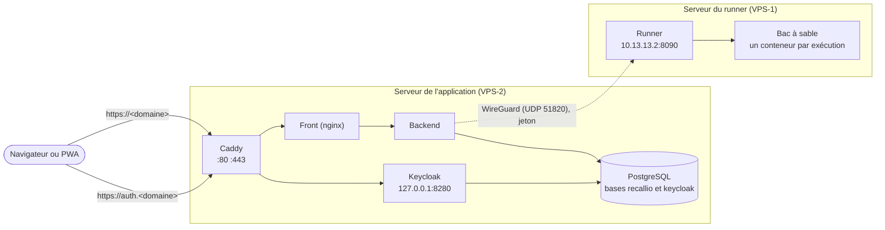

# Déployer et exploiter Recallio

> Pour le propriétaire du projet, qui monte et fait vivre les serveurs de la bêta. Chaque étape donne les commandes à
> copier et ce qu'on doit voir. Les décisions sont dans les ADR [0069](adr/0069-hebergement-et-livraison.md) (deux
> serveurs, des images publiées par la CI), [0070](adr/0070-logs-et-erreurs.md) (logs et Sentry),
> [0071](adr/0071-le-serveur-de-l-application.md) (le serveur de l'application) et
> [0072](adr/0072-le-serveur-du-runner.md) (le serveur du runner).
>
> État : le serveur de l'application (étape 7.3) et le serveur du runner (7.4, section 11). Les sauvegardes (7.5) et la
> mise en service (7.7) compléteront ce document, à leurs sections annoncées en fin de page.

Conventions :

- `<domaine>` est le domaine du site (par exemple `recallio.fr`), `<ip>` l'adresse IPv4 du serveur de l'application,
  `<ip-runner>` celle du serveur du runner (section 11), `recallio` l'utilisateur que l'on crée sur chaque serveur
  (section 3) ;
- une commande précédée de « Sur ton poste » se tape sur ta machine, dans Git Bash sous Windows (dans PowerShell,
  `curl` n'est pas le vrai curl, et `grep` manque), sauf mention de PowerShell ; les autres, sur le serveur, connecté
  en SSH ;
- toutes les commandes `docker compose` se lancent depuis `/opt/recallio/infra/production/app`, sauf celles du serveur
  du runner, depuis `/opt/recallio/infra/production/runner` (section 11).

## 1. Vue d'ensemble



| Service | Ce qu'il fait | Joignable depuis Internet |
|---|---|---|
| Caddy | HTTPS (certificats Let's Encrypt), HSTS ; relaie `<domaine>` vers le front et `auth.<domaine>` vers Keycloak | oui : 80 et 443 |
| Front | nginx : la PWA, et `/api` relayé vers le backend | non : par Caddy |
| Backend | L'API ; importe le contenu à chaque démarrage | non : par le front |
| Keycloak | Les comptes, la connexion, les e-mails (Brevo) ; sa console d'administration | ses pages de connexion, par Caddy ; sa console, par un tunnel SSH seulement |
| PostgreSQL | Deux bases : `recallio` et `keycloak` | non |
| Runner, sur son serveur | Exécute le code des joueurs (exercices, Tour) dans un conteneur jetable par exécution | non : le backend seul, par le tunnel WireGuard, avec le jeton |

**Ce qui est secret** : sur le serveur de l'application, tout est dans un seul fichier,
`/opt/recallio/infra/production/app/.env`, lisible par toi seul (`chmod 600`), jamais versionné. Il porte les mots de
passe de PostgreSQL, celui du compte Keycloak temporaire, la clé SMTP de Brevo, le jeton du runner et les clés VAPID.
**Garde-en une copie hors du serveur** (un gestionnaire de mots de passe) : sans lui, une restauration ne peut pas se
reconnecter à la base, et de nouvelles clés VAPID désabonnent tout le monde des rappels. Le reste du dossier vient du
dépôt public et ne contient aucun secret. Le serveur du runner a son propre `.env` (le même jeton), et chaque serveur
ses clés WireGuard dans `/etc/wireguard/` ; la clé partagée du tunnel se garde avec le jeton (section 11).

## 2. Les prérequis

### Le domaine

Acheté chez le registraire de ton choix, une fois vérifié que « Recallio » n'est pas une marque déposée dans ta classe
(INPI, EUIPO ; ADR 0069).

### Les enregistrements DNS

Chez le registraire, trois enregistrements `A`, vers l'adresse IPv4 du serveur de l'application :

| Nom | Type | Valeur |
|---|---|---|
| `<domaine>` (souvent noté `@`) | `A` | `<ip>` |
| `www` | `A` | `<ip>` |
| `auth` | `A` | `<ip>` |

**Pas d'enregistrement `AAAA` (IPv6) pour la bêta**, et supprime ceux que le registraire aurait créés : derrière Docker,
un visiteur IPv6 arriverait avec l'adresse de la passerelle de Docker, et la limite de débit les compterait tous comme
un seul visiteur (ADR 0071).

Vérifier (sur ton poste, quelques minutes à quelques heures après) :

```shell
nslookup <domaine>
nslookup www.<domaine>
nslookup auth.<domaine>
```

Attendu : chacun répond `<ip>`, et aucun ne donne d'adresse IPv6.

### Brevo, pour les e-mails de Keycloak

Keycloak envoie la vérification de l'adresse et le « mot de passe oublié » par le relais SMTP de Brevo.

1. Crée un compte Brevo ; l'offre gratuite suffit pour une bêta.
2. **Authentifie le domaine expéditeur** : dans les réglages de Brevo, la page des domaines expéditeurs, ajoute
   `<domaine>`. Brevo affiche les enregistrements à créer chez le registraire ; les valeurs affichées font foi :
   - le **code Brevo**, un enregistrement `TXT` qui prouve que le domaine est à toi ;
   - **DKIM**, en général deux `CNAME` (`brevo1._domainkey`, `brevo2._domainkey`), qui signent les e-mails ;
   - **DMARC**, un `TXT` sur `_dmarc`, par exemple `v=DMARC1; p=none; rua=mailto:<ton adresse>` pour commencer, à durcir
     (`p=quarantine`) une fois que tout passe ;
   - **SPF** : Brevo n'en demande pas, il envoie avec sa propre adresse de retour et s'aligne sur DMARC par DKIM.
3. Attends que Brevo marque le domaine **authentifié** (jusqu'à 48 heures).
4. Crée une **clé SMTP** : dans *SMTP & API*, onglet *SMTP*, génère une nouvelle clé. Note l'identifiant (*Login*)
   affiché sur cette page et la clé : ce sont `SMTP_USER` et `SMTP_PASSWORD` (section 5). Une clé SMTP, pas une clé
   d'API.

### Sentry, facultatif

Si tu veux les erreurs dans Sentry (ADR 0070) : un compte en région UE, deux projets pour ce serveur
(`recallio-backend`, `recallio-frontend`) et leurs DSN, réglés comme le dit l'ADR 0070. Sans DSN, rien n'est envoyé.

### Le serveur

Un VPS-2 d'OVHcloud, en **Debian 13** ou **Ubuntu 24.04 LTS**, avec ta clé SSH publique ajoutée à la commande. OVHcloud
t'envoie son adresse IPv4 et le nom de l'utilisateur créé (`debian` ou `ubuntu`).

## 3. Préparer le serveur

### Un utilisateur à toi, SSH par clé seulement

Sur ton poste, connecte-toi avec l'utilisateur d'OVHcloud :

```shell
ssh debian@<ip>      # ou ubuntu@<ip>
```

Crée ton utilisateur, donne-lui `sudo` et ta clé :

```shell
sudo adduser recallio                 # choisis un mot de passe : il servira à sudo
sudo usermod -aG sudo recallio
sudo install -d -m 700 -o recallio -g recallio /home/recallio/.ssh
sudo install -m 600 -o recallio -g recallio ~/.ssh/authorized_keys /home/recallio/.ssh/authorized_keys
```

Dans un **second terminal**, sans fermer le premier, vérifie que tu entres avec ta clé :

```shell
ssh recallio@<ip>
sudo whoami
```

Attendu : `root`. Puis interdis les mots de passe et `root` en SSH. Le fichier commence par `00-` pour passer avant
ceux de l'image (le premier réglage lu gagne) :

```shell
printf 'PasswordAuthentication no\nKbdInteractiveAuthentication no\nPermitRootLogin no\n' \
  | sudo tee /etc/ssh/sshd_config.d/00-recallio.conf
sudo sshd -t && sudo systemctl restart ssh
sudo sshd -T | grep -E '^(passwordauthentication|kbdinteractiveauthentication|permitrootlogin) '
```

Attendu : les trois lignes valent `no`. Vérifie encore, dans un nouveau terminal, que `ssh recallio@<ip>` passe ;
ensuite seulement, ferme le premier. Désormais, connecte-toi toujours en `recallio`.

### Le pare-feu

```shell
sudo apt-get update && sudo apt-get install -y ufw
sudo ufw default deny incoming
sudo ufw default allow outgoing
sudo ufw allow 22/tcp
sudo ufw allow 80/tcp
sudo ufw allow 443/tcp
sudo ufw allow 443/udp
sudo ufw enable
sudo ufw status verbose
```

Attendu : `Status: active`, et des règles `ALLOW IN` pour `22/tcp`, `80/tcp`, `443/tcp` et `443/udp` (en IPv4 et en
IPv6).

**Attention : Docker contourne `ufw` pour les ports qu'il publie.** Il écrit ses propres règles de pare-feu, lues avant
celles d'`ufw` : un port publié par un conteneur est joignable depuis Internet même si `ufw` ne l'autorise pas. C'est
pourquoi le compose ne publie que les ports de Caddy, et celui de la console de Keycloak sur `127.0.0.1` seulement. Ne
publie jamais un autre port sans `127.0.0.1:` devant.

### Les mises à jour de sécurité automatiques

```shell
sudo apt-get update && sudo apt-get full-upgrade -y
sudo apt-get install -y unattended-upgrades
sudo dpkg-reconfigure --priority=low unattended-upgrades     # réponds « Oui »
cat /etc/apt/apt.conf.d/20auto-upgrades
```

Attendu : `APT::Periodic::Update-Package-Lists "1";` et `APT::Periodic::Unattended-Upgrade "1";`. Les correctifs de
sécurité du système s'installent chaque nuit. Un nouveau noyau demande un redémarrage : quand le fichier
`/var/run/reboot-required` existe, redémarre (`sudo reboot`) à une heure creuse ; les conteneurs repartent seuls.

### Docker Engine et le plugin Compose

Depuis le dépôt officiel de Docker, pas le paquet de la distribution (la page
[docs.docker.com/engine/install/debian](https://docs.docker.com/engine/install/debian/), ou `/ubuntu/`, fait foi si elle
a changé) :

```shell
sudo apt-get install -y ca-certificates curl
sudo install -m 0755 -d /etc/apt/keyrings
sudo curl -fsSL https://download.docker.com/linux/debian/gpg -o /etc/apt/keyrings/docker.asc
sudo chmod a+r /etc/apt/keyrings/docker.asc
echo "deb [arch=$(dpkg --print-architecture) signed-by=/etc/apt/keyrings/docker.asc] https://download.docker.com/linux/debian $(. /etc/os-release && echo "$VERSION_CODENAME") stable" \
  | sudo tee /etc/apt/sources.list.d/docker.list > /dev/null
sudo apt-get update
sudo apt-get install -y docker-ce docker-ce-cli containerd.io docker-buildx-plugin docker-compose-plugin
```

Sur Ubuntu, remplace `debian` par `ubuntu` dans les deux adresses. Puis donne Docker à ton utilisateur (le groupe
`docker` vaut les droits root : ne l'accorde à personne d'autre), et reconnecte-toi :

```shell
sudo usermod -aG docker recallio
exit
```

```shell
ssh recallio@<ip>
docker run --rm hello-world
docker compose version
```

Attendu : « Hello from Docker! », puis `Docker Compose version v2.…`. Docker ne se met pas à jour avec les correctifs
automatiques : une fois par mois, `sudo apt-get update && sudo apt-get upgrade` (les conteneurs redémarrent, voir
section 10).

### L'heure en UTC

```shell
sudo timedatectl set-timezone Etc/UTC
timedatectl
```

Attendu : `Time zone: Etc/UTC (UTC, +0000)` et `System clock synchronized: yes`. Les logs et la base sont en UTC ; le
fuseau des utilisateurs vient de leur navigateur.

## 4. Récupérer la configuration

Le dépôt est public : on le clone à un emplacement fixe, sans identifiant. On ne se sert que de
`infra/production/app/` ; rien n'est construit sur le serveur.

```shell
sudo apt-get install -y git openssl
sudo install -d -o recallio -g recallio /opt/recallio
git clone https://github.com/potichacha/recallio.git /opt/recallio
cd /opt/recallio/infra/production/app
ls -A
```

Attendu : `.env.example  Caddyfile  compose.yaml  keycloak  postgres`.

## 5. Configurer

### Le fichier `.env`

```shell
cd /opt/recallio/infra/production/app
cp .env.example .env
chmod 600 .env
ls -l .env
```

Attendu : `-rw------- 1 recallio recallio … .env`. Chaque variable y est commentée.

### Les secrets

Chaque secret est tiré au hasard et écrit directement dans le `.env`, sans passer par l'écran :

```shell
for v in POSTGRES_PASSWORD RECALLIO_DB_PASSWORD KEYCLOAK_DB_PASSWORD RECALLIO_RUNNER_TOKEN; do
  sed -i "s/^$v=$/$v=$(openssl rand -hex 32)/" .env
done
sed -i "s/^KEYCLOAK_BOOTSTRAP_ADMIN_PASSWORD=$/KEYCLOAK_BOOTSTRAP_ADMIN_PASSWORD=$(openssl rand -hex 16)/" .env
```

Le jeton du runner devra être le même dans le `.env` du serveur du runner (section 11).

### Les clés VAPID, une fois pour toutes

Les rappels par notification (ADR 0047) signent leurs envois avec une paire de clés P-256. Le backend les attend brutes,
en base64url : la clé publique (le point non compressé, 65 octets) et la clé privée (32 octets). **Ne les change plus
ensuite** : de nouvelles clés désabonnent tous les appareils.

```shell
openssl ecparam -name prime256v1 -genkey -noout -out /tmp/vapid.pem
pub=$(openssl ec -in /tmp/vapid.pem -pubout -outform DER 2>/dev/null | tail -c 65 | openssl base64 -A | tr '+/' '-_' | tr -d '=')
priv=$(openssl ec -in /tmp/vapid.pem -outform DER 2>/dev/null | head -c 39 | tail -c 32 | openssl base64 -A | tr '+/' '-_' | tr -d '=')
sed -i "s/^RECALLIO_PUSH_VAPID_PUBLIC_KEY=.*/RECALLIO_PUSH_VAPID_PUBLIC_KEY=$pub/; s/^RECALLIO_PUSH_VAPID_PRIVATE_KEY=.*/RECALLIO_PUSH_VAPID_PRIVATE_KEY=$priv/" .env
shred -u /tmp/vapid.pem
unset pub priv
grep VAPID .env | awk -F= '{ print $1, length($2) }'
```

Attendu : `RECALLIO_PUSH_VAPID_PUBLIC_KEY 87` et `RECALLIO_PUSH_VAPID_PRIVATE_KEY 43`.

### Le reste, à la main

```shell
nano .env
```

- `DOMAIN` : `<domaine>`, sans `https://` ; `ACME_EMAIL` : ton adresse, pour Let's Encrypt ;
- `SMTP_USER` et `SMTP_PASSWORD` : l'identifiant et la clé SMTP de Brevo (section 2) ; `SMTP_REPLY_TO`, si tu veux qu'on
  puisse répondre aux e-mails ;
- `RECALLIO_PUSH_SUBJECT` : `mailto:` suivi de ton adresse ;
- `RECALLIO_RUNNER_URL` : garde la valeur d'exemple, `http://10.13.13.2:8090`, l'adresse du runner dans le tunnel
  WireGuard (section 11). Tant que le serveur du runner n'est pas monté, rendre un exercice répond 503 ; le reste
  fonctionne ;
- `SENTRY_DSN_BACKEND`, `SENTRY_DSN_FRONTEND`, `SENTRY_ORIGIN_FRONTEND` : facultatifs ;
- `RECALLIO_TAG` : ci-dessous.

### Le tag à déployer

Le serveur épingle les images d'un commit de `main` dont le **job `publish` est entièrement vert** (les sept images
publiées) : sur GitHub, *Actions*, *CI*, branche `main`, un run vert jusqu'aux sept `publish (…)`. Le tag est `sha-`
suivi des 12 premiers caractères du commit. Sur ton poste, avec la CLI de GitHub :

```shell
gh run list --repo potichacha/recallio --workflow ci.yml --branch main --status success --limit 5 --json headSha,displayTitle
```

Puis, sur le serveur, `RECALLIO_TAG=sha-<12 caractères>` dans le `.env`. Les paquets GHCR doivent être publics
(ADR 0069) : le serveur les tire sans identifiant.

### Vérifier la configuration

```shell
docker compose config --quiet && echo OK
```

Attendu : `OK`. Sinon, Compose nomme la variable qui manque (« required variable SMTP_USER is missing a value »).

## 6. Premier démarrage

```shell
cd /opt/recallio/infra/production/app
docker compose pull
docker compose up -d
docker compose logs -f
```

`Ctrl+C` quitte les logs sans rien arrêter. Dans l'ordre, tu dois voir :

1. **PostgreSQL** initialise sa base, puis lance le script des bases et des rôles :
   `running /docker-entrypoint-initdb.d/init-databases.sql`. Ce script ne s'exécute **qu'une fois**, sur un volume
   vide : changer ensuite un mot de passe dans le `.env` ne change pas celui de la base (section 10).
2. **Keycloak** prépare sa configuration (quelques lignes de texte, normal), crée ses tables, importe le royaume
   (`Realm 'recallio' imported`) et crée le compte temporaire (`Created temporary admin user with username temp-admin`).
3. **Le backend** attend Keycloak, applique les migrations Flyway, importe le contenu (une dizaine de secondes sur une
   base neuve), puis `started in …`.
4. **Le front**, puis **Caddy**, qui obtient les trois certificats : `certificate obtained successfully` pour
   `<domaine>`, `www.<domaine>` et `auth.<domaine>`.

Compte une à deux minutes. Puis :

```shell
docker compose ps
```

Attendu : les cinq services `Up … (healthy)`.

## 7. Keycloak

### Ouvrir la console d'administration

La console n'est pas sur Internet : `https://auth.<domaine>/admin/` répond 404. Elle écoute sur `127.0.0.1:8280` du
serveur, que l'on joint par un tunnel SSH.

**Une fois, au premier démarrage**, sur le serveur : donne au royaume `master` l'adresse du tunnel. Sans cela, la
console chargerait, mais sa connexion passerait par `https://auth.<domaine>/realms/master/`, que Caddy refuse
(ADR 0071). La commande utilise le compte temporaire, dont le mot de passe est déjà dans le conteneur :

```shell
docker compose exec keycloak sh -c '/opt/keycloak/bin/kcadm.sh update realms/master --no-config --server http://localhost:8080 --realm master --user temp-admin --password "$KC_BOOTSTRAP_ADMIN_PASSWORD" -s attributes.frontendUrl=http://localhost:8280'
```

Attendu : `Logging into http://localhost:8080 as user temp-admin of realm master`, et rien d'autre.

Puis, **sur ton poste**, à chaque fois que tu as besoin de la console :

```shell
ssh -N -L 8280:127.0.0.1:8280 recallio@<ip>
```

La commande ne rend pas la main tant que le tunnel est ouvert (`Ctrl+C` le ferme). Ouvre
[http://localhost:8280/admin/](http://localhost:8280/admin/) : la page de connexion du royaume `master`. Le port 8280
évite celui du Keycloak de développement (8180).

### Un administrateur permanent, avec OTP

1. Connecte-toi en `temp-admin`, avec le mot de passe du `.env` (`grep KEYCLOAK_BOOTSTRAP .env`, sur le serveur).
2. Royaume `master` (en haut à gauche), *Users*, *Create new user* : un nom, ton adresse, *Email verified* activé ; dans
   *Required user actions*, choisis *Configure OTP*. *Create*.
3. Onglet *Credentials*, *Set password* : un mot de passe long, *Temporary* désactivé.
4. Onglet *Role mapping*, *Assign role*, filtre *Filter by realm roles*, coche `admin`, *Assign*.
5. Déconnecte-toi (en haut à droite), reconnecte-toi avec ce compte : Keycloak te fait enregistrer l'OTP dans une
   application d'authentification. Il le demandera à chaque connexion.
6. *Users*, `temp-admin`, *Delete*.
7. Sur le serveur, vide le mot de passe temporaire (Keycloak ne s'en sert plus, il n'a rien à faire sur le serveur) :

   ```shell
   sed -i 's/^KEYCLOAK_BOOTSTRAP_ADMIN_PASSWORD=.*/KEYCLOAK_BOOTSTRAP_ADMIN_PASSWORD=/' .env
   docker compose up -d keycloak
   ```

   Keycloak redémarre (une trentaine de secondes sans connexion possible ; les sessions sont gardées).

### Ton compte dans Recallio, avec le rôle `admin`

1. Sur `https://<domaine>`, *Se connecter*, puis *Enregistrement* : inscris-toi comme n'importe qui, suis le lien de
   l'e-mail, choisis ton mot de passe. Tu reviens connecté dans la PWA.
2. Dans la console, royaume `recallio`, *Users*, ton compte, *Role mapping*, *Assign role*, *Filter by realm roles*,
   `admin`, *Assign*.
3. Dans la PWA, déconnecte-toi et reconnecte-toi : ton nouveau jeton porte le rôle `admin` (les sujets en brouillon et
   les pages des admins apparaissent).

### Tester l'envoi d'un e-mail

Dans la console, royaume `recallio`, *Realm settings*, onglet *Email*, *Test connection* : Keycloak envoie un e-mail de
test à l'adresse de ton administrateur `master`. Attendu : un message de réussite, et l'e-mail reçu (regarde aussi les
indésirables). Les réglages SMTP du `.env` n'ont servi qu'à l'import : désormais, ils se changent sur cet onglet.

## 8. Vérifier

Sur ton poste :

```shell
curl -sI https://<domaine>/ | grep -iE '^(HTTP|strict-transport-security)'
curl -sI https://auth.<domaine>/realms/recallio/account/ | grep -iE '^(HTTP|strict-transport-security)'
curl -sI https://www.<domaine>/ | grep -iE '^(HTTP|location)'
curl -s -o /dev/null -w '%{http_code}\n' https://auth.<domaine>/admin/
curl -s -o /dev/null -w '%{http_code}\n' https://auth.<domaine>/realms/master/.well-known/openid-configuration
curl -s https://auth.<domaine>/realms/recallio/.well-known/openid-configuration | grep -o '"issuer":"[^"]*"'
curl -s https://<domaine>/api/v1/health
```

Attendu, dans l'ordre :

- `HTTP/2 200` (ou `HTTP/1.1 200`, selon ton curl) et `strict-transport-security: max-age=31536000; includeSubDomains` ;
- la même chose pour Keycloak ;
- `HTTP/2 301` et `location: https://<domaine>/` ;
- `404` (la console n'est pas sur Internet) ;
- `404` (le royaume `master` non plus) ;
- `"issuer":"https://auth.<domaine>/realms/recallio"` ;
- `{ "status": "UP", … }`.

Puis, dans un navigateur :

- `https://<domaine>` : la page d'accueil ; l'essai sans compte fonctionne ;
- **une inscription complète**, avec une autre adresse que la tienne : la page de Keycloak est en français, l'e-mail
  de vérification arrive de « Recallio <no-reply@<domaine>> », son lien fait choisir le mot de passe (10 caractères au
  moins) puis ramène connecté dans la PWA ;
- la connexion avec « Se souvenir de moi » : le lendemain, *Se connecter* reconnecte sans formulaire.

Enfin, que rien d'autre n'est ouvert (sur ton poste, dans PowerShell) :

```powershell
Test-NetConnection <ip> -Port 8280 | Select-Object TcpTestSucceeded
Test-NetConnection <ip> -Port 5432 | Select-Object TcpTestSucceeded
```

Attendu : `False` deux fois (après quelques secondes d'attente chacun).

## 9. Mettre à jour, revenir en arrière

### Une nouvelle version de Recallio

Les deux serveurs portent le même tag. **Le serveur du runner d'abord** (section 11, « Mettre à jour ») : un nouveau
backend ne parle ainsi jamais à un ancien runner. Puis, sur le serveur de l'application :

```shell
cd /opt/recallio/infra/production/app
git pull                                      # seulement si infra/production/app a changé
diff <(grep -oE '^[A-Z_]+=' .env.example) <(grep -oE '^[A-Z_]+=' .env)
nano .env                                     # RECALLIO_TAG=sha-<nouveau commit>
docker compose pull
docker compose up -d
docker compose ps
```

- Le `diff` ne doit rien afficher : une ligne `<` est une variable apparue dans `.env.example`, à ajouter au `.env`.
- Compose ne recrée que le backend et le front, dont l'image a changé ; Keycloak, PostgreSQL et Caddy ne bougent pas, et
  les sessions restent ouvertes.
- **L'indisponibilité attendue** : l'API répond 502 d'environ **20 secondes**, le temps que le nouveau backend démarre,
  importe le contenu (quelques secondes quand il n'a pas changé, ADR 0069) et soit déclaré prêt, puis que le front
  redémarre après lui.
- Note le tag précédent (en commentaire dans le `.env`, par exemple) : c'est le chemin du retour.

**Revenir en arrière**, c'est remettre le tag précédent, puis `docker compose pull` et `up -d` : ici d'abord, puis sur
le serveur du runner, dans l'ordre inverse de la mise à jour. Les migrations Flyway ne se défont pas : l'ancien code
tourne sur le nouveau schéma, ce que la règle des migrations rétrocompatibles permet (CLAUDE.md, section 7).

### Caddy, Keycloak et PostgreSQL

Leurs images sont épinglées à une version mineure (`caddy:2.11`, `keycloak:26.7`, `postgres:18`) :

- **les correctifs** de ces versions arrivent avec `docker compose pull` puis `up -d`. Fais-le une fois par mois, avec
  la mise à jour de Docker (section 3) ;
- **une nouvelle version mineure** arrive par une pull request de Dependabot (`caddy:2.12`, `keycloak:26.8`…) : après le
  merge, `git pull`, `docker compose pull`, `up -d`. Pour **Keycloak**, lis d'abord ses notes de mise à jour
  (*Upgrading Guide*) : il migre sa base au démarrage, sans retour possible autrement que par une sauvegarde
  (section 12) ; et reporte la version dans le compose local (`infra/compose.yaml`) ;
- **une version majeure de PostgreSQL** (18 vers 19) demande une vraie migration : la nouvelle version ne lit pas les
  fichiers de l'ancienne. Dependabot ne la propose pas. Le principe : une sauvegarde complète (`pg_dumpall`), puis la
  nouvelle image sur un volume neuf, puis la restauration, en gardant l'ancien volume jusqu'à ce que tout soit vérifié.
  La procédure exacte s'écrira et se répétera sur une copie avant le jour venu, avec celle des sauvegardes (section 12).

## 10. Exploiter

### Lire les logs

Chaque service écrit en JSON, une ligne par événement, sans adresse IP ni donnée personnelle (ADR 0070, 0071). Docker
en garde 5 fichiers de 10 Mo par conteneur.

```shell
docker compose logs --tail 100 backend
docker compose logs -f --since 10m frontend
docker compose ps
```

Pour filtrer (`sudo apt-get install -y jq`), par exemple les erreurs du backend, ou les réponses 5xx du front :

```shell
docker compose logs --no-log-prefix backend | jq -R 'fromjson? | select(.level == "ERROR") | .message'
docker compose logs --no-log-prefix frontend | jq -R -c 'fromjson? | select(.status >= 500)'
```

### L'espace disque

```shell
df -h /
docker system df
docker image prune
```

`docker image prune` supprime les images qui ne servent plus à rien (sans tag). Les anciennes versions de Recallio
restent jusqu'à `docker image prune -a`, qui supprime toute image qu'aucun conteneur n'utilise : sans danger, pour
revenir en arrière, `docker compose pull` les tire de nouveau de GHCR.

### Redémarrer

```shell
docker compose restart keycloak            # un service
docker compose restart backend frontend    # le backend, toujours avec le front, qui le retrouve ainsi
docker compose down && docker compose up -d   # tout, dans l'ordre (les volumes restent)
```

Préfère `down` puis `up -d` pour tout redémarrer : `docker compose restart`, comme un redémarrage du serveur, relance
tout en même temps ; le backend démarre alors avant Keycloak, écrit une erreur (envoyée à Sentry), et se connecte à la
première requête.

### Changer un mot de passe de la base

Le script d'initialisation ne s'exécute plus : on change le mot de passe dans PostgreSQL, puis dans le `.env`.

```shell
docker compose exec postgres psql -U postgres
```

Dans psql, `\password recallio` (ou `\password keycloak`), puis `\q`. Reporte-le dans le `.env`
(`RECALLIO_DB_PASSWORD` ou `KEYCLOAK_DB_PASSWORD`), puis `docker compose up -d`.

### Dépannage

| Symptôme | Cause probable | Que faire |
|---|---|---|
| `docker compose up` refuse : « required variable … is missing a value » | Une variable du `.env` est vide | La remplir (section 5) |
| Le site répond par une erreur de certificat | Caddy n'a pas obtenu ses certificats | `docker compose logs caddy` : le DNS ne pointe pas vers `<ip>`, ou le port 80 est fermé (`sudo ufw status`). Ne supprime jamais le volume `caddy-data` : Let's Encrypt limite les demandes (5 certificats identiques par semaine) |
| Le backend reste `unhealthy` | La base ou Keycloak | `docker compose logs backend` : « password authentication failed », le mot de passe du `.env` n'est plus celui de la base (section 10, « Changer un mot de passe ») ; une erreur OIDC, Keycloak n'est pas prêt (`docker compose ps`) |
| `https://<domaine>/api/…` répond 502 | Le backend démarre, ou le front ne l'a pas retrouvé après sa recréation | Attendre 30 secondes ; sinon `docker compose restart frontend` |
| L'e-mail de vérification n'arrive pas | Brevo, le domaine ou les indésirables | Les indésirables ; *Transactional*, *Logs* dans Brevo ; *Test connection* dans la console (section 7) ; un changement du `.env` sur SMTP n'a pas d'effet après le premier démarrage : il se fait dans la console |
| La connexion échoue : « Invalid parameter: redirect_uri » | Le domaine a changé après l'import du royaume | Dans la console, royaume `recallio`, *Clients*, `recallio-frontend` : corriger les adresses |
| La console, par le tunnel, reste blanche ou redirige vers `https://auth.<domaine>/realms/master/…` | L'adresse du royaume `master` n'est pas réglée | La commande `kcadm.sh` de la section 7 |
| Plus aucun administrateur Keycloak (OTP perdu) | | Le guide de Keycloak « Bootstrapping and recovering an admin account » (commande `bootstrap-admin`) |
| Une erreur « Failed to create OidcProviderClientImpl » dans Sentry, après un redémarrage du serveur | Le backend a démarré avant Keycloak | Rien : il se connecte à la première requête |

## 11. Le serveur du runner

Ce serveur ne porte que le runner et les images du bac à sable : l'accès du runner au socket Docker vaut les droits root
sur l'hôte (ADR 0030). Le backend le joint par un tunnel WireGuard, de `10.13.13.1` (l'application) à `10.13.13.2`
(le runner), avec le jeton partagé. Les décisions sont dans l'ADR [0072](adr/0072-le-serveur-du-runner.md).

Dans cette section, `<ip-runner>` est l'adresse IPv4 publique du serveur du runner, et `<ip>` reste celle du serveur de
l'application. Chaque bloc dit sur quel serveur il se tape ; les commandes `docker compose` du runner se lancent depuis
`/opt/recallio/infra/production/runner`.

### Le serveur

Un VPS-1 d'OVHcloud (2 vCores, 4 Go), en **Debian 13** ou **Ubuntu 24.04 LTS** (la même que l'application, pour n'avoir
qu'une façon de faire), avec ta clé SSH publique ajoutée à la commande.

### Préparer le serveur

Sur le runner, suis la section 3, avec `<ip-runner>` à la place de `<ip>` : un utilisateur à toi et SSH par clé
seulement, les mises à jour de sécurité automatiques, Docker Engine et le plugin Compose, l'heure en UTC. **Sauf le
pare-feu**, qui diffère : ci-dessous, à la place de celui de la section 3. **Puis les core dumps**, une fois Docker
installé.

#### Le pare-feu

Sur le runner, à la place de « Le pare-feu » de la section 3 :

```shell
sudo apt-get update && sudo apt-get install -y ufw
sudo ufw default deny incoming
sudo ufw default allow outgoing
sudo ufw allow 22/tcp
sudo ufw allow from <ip> to any port 51820 proto udp
sudo ufw enable
sudo ufw status verbose
```

Attendu : `Status: active`, `22/tcp ALLOW IN Anywhere` (en IPv4 et en IPv6) et `51820/udp ALLOW IN <ip>` : WireGuard,
depuis le seul serveur de l'application. Ni 80, ni 443, ni 8090 : Docker publie le port du runner lui-même, sur
l'adresse du tunnel seulement.

Le serveur de l'application, lui, n'ouvre **aucun port de plus** : c'est lui qui appelle, et `ufw` laisse revenir les
réponses d'une connexion qu'il a ouverte ; l'envoi d'un paquet toutes les 25 secondes (`PersistentKeepalive`) la garde
ouverte.

#### Les core dumps

Une fois Docker installé. Un programme C++ qui plante dans le bac à sable ne doit rien laisser sur l'hôte (ADR 0053).
Sur Ubuntu, apport (ou systemd-coredump, s'il est installé) reçoit l'image mémoire de tout programme qui plante,
conteneurs compris, malgré leurs limites : le noyau la lui confie quand le motif `kernel.core_pattern` commence par `|`.
Sur le runner :

```shell
printf 'kernel.core_pattern=core\nfs.suid_dumpable=0\n' | sudo tee /etc/sysctl.d/90-recallio-core-dumps.conf
sudo systemctl disable --now apport.service && sudo systemctl mask apport.service    # sur Ubuntu seulement
sudo sysctl --system > /dev/null
sysctl kernel.core_pattern fs.suid_dumpable
```

Attendu : `kernel.core_pattern = core` et `fs.suid_dumpable = 0`. Sur Debian, apport n'existe pas : saute la deuxième
ligne. Ne désinstalle pas apport sur Ubuntu : le méta-paquet `ubuntu-server` partirait avec lui.

Puis une limite de 0 pour l'image mémoire de tout conteneur ; sans elle, le noyau l'écrirait dans le conteneur :

```shell
printf '{\n  "default-ulimits": {\n    "core": { "Name": "core", "Hard": 0, "Soft": 0 }\n  }\n}\n' | sudo tee /etc/docker/daemon.json
sudo systemctl restart docker
```

Sur un Docker neuf, `/etc/docker/daemon.json` n'existe pas ; s'il existe déjà, ajoute-y la clé `default-ulimits` à la
main plutôt que de l'écraser. La vérification vient après le premier démarrage (« Vérifier »).

### Récupérer la configuration

Le même dépôt, au même emplacement ; on ne se sert que de `infra/production/runner/`. Sur le runner :

```shell
sudo apt-get install -y git jq
sudo install -d -o recallio -g recallio /opt/recallio
git clone https://github.com/potichacha/recallio.git /opt/recallio
cd /opt/recallio/infra/production/runner
ls -A
```

Attendu : `.env.example  compose.yaml  wireguard`. Sur le serveur de l'application, `git pull` dans `/opt/recallio`,
pour avoir `infra/production/app/wireguard/`.

### WireGuard, sur les deux serveurs

**Les clés.** Sur chacun des deux serveurs :

```shell
sudo apt-get install -y wireguard-tools iputils-ping
sudo sh -c 'cd /etc/wireguard && umask 077 && wg genkey > private.key && wg pubkey < private.key > public.key'
sudo cat /etc/wireguard/public.key
```

Attendu : 44 caractères qui finissent par `=`, la clé publique du serveur. Note les deux : elles ne sont pas secrètes.
La clé privée, elle, ne quitte jamais son serveur.

**La clé partagée**, tirée une fois, sur le runner :

```shell
sudo sh -c 'umask 077 && wg genpsk > /etc/wireguard/preshared.key'
sudo cat /etc/wireguard/preshared.key
```

Copie-la, puis recopie-la sur le serveur de l'application (la commande attend que tu la colles, sans l'afficher) :

```shell
read -rsp 'Clé partagée : ' psk && echo
printf '%s\n' "$psk" | sudo sh -c 'umask 077 && cat > /etc/wireguard/preshared.key' && unset psk
sudo wc -c /etc/wireguard/preshared.key
```

Attendu : `45 /etc/wireguard/preshared.key`. Comme le jeton du runner, elle est secrète : garde-la dans ton gestionnaire
de mots de passe, jamais dans un fichier de ton poste.

**Le tunnel, côté runner.** Sur le runner, remplace `COLLE-ICI…` par la clé publique du serveur de l'application :

```shell
cd /opt/recallio/infra/production/runner
sudo install -m 600 wireguard/wg0.conf.example /etc/wireguard/wg0.conf
sudo sh -c 'sed -i "s|<RUNNER_PRIVATE_KEY>|$(cat /etc/wireguard/private.key)|; s|<PRESHARED_KEY>|$(cat /etc/wireguard/preshared.key)|" /etc/wireguard/wg0.conf'
app_public_key=COLLE-ICI-LA-CLE-PUBLIQUE-DE-L-APPLICATION
sudo sed -i "s|<APP_PUBLIC_KEY>|$app_public_key|" /etc/wireguard/wg0.conf
sudo grep -c '<[A-Z_]*>' /etc/wireguard/wg0.conf
sudo ls -l /etc/wireguard/wg0.conf
```

Attendu : `0` (plus aucun marqueur), et `-rw------- 1 root root`.

**Le tunnel, côté application.** Sur le serveur de l'application, avec la clé publique du runner et `<ip-runner>` :

```shell
cd /opt/recallio/infra/production/app
sudo install -m 600 wireguard/wg0.conf.example /etc/wireguard/wg0.conf
sudo sh -c 'sed -i "s|<APP_PRIVATE_KEY>|$(cat /etc/wireguard/private.key)|; s|<PRESHARED_KEY>|$(cat /etc/wireguard/preshared.key)|" /etc/wireguard/wg0.conf'
runner_public_key=COLLE-ICI-LA-CLE-PUBLIQUE-DU-RUNNER
sudo sed -i "s|<RUNNER_PUBLIC_KEY>|$runner_public_key|; s|<RUNNER_PUBLIC_IP>|<ip-runner>|" /etc/wireguard/wg0.conf
sudo grep -c '<[A-Z_]*>' /etc/wireguard/wg0.conf
```

Attendu : `0`.

**Démarrer**, sur le runner d'abord, puis sur l'application :

```shell
sudo systemctl enable --now wg-quick@wg0
```

Puis, sur l'application :

```shell
ping -c 3 10.13.13.2
sudo wg show
```

Attendu : trois réponses ; puis `latest handshake: … seconds ago`, `transfer: … received, … sent` et
`persistent keepalive: every 25 seconds`. Sur le runner :

```shell
ping -c 3 10.13.13.1
sudo wg show
```

Attendu : trois réponses, et pour le pair `endpoint: <ip>:<port>` et une poignée de main récente. Le tunnel redémarre
seul avec chaque serveur (`enable`).

### Docker après WireGuard

Le runner publie son port sur `10.13.13.2`, qui n'existe qu'une fois `wg0` monté. Si Docker démarre avant, la liaison
échoue, le runner reste arrêté, et **Docker ne réessaie jamais** (ADR 0072). Un « drop-in » systemd fait attendre
Docker. Sur le runner :

```shell
sudo mkdir -p /etc/systemd/system/docker.service.d
printf '[Unit]\nAfter=wg-quick@wg0.service\nWants=wg-quick@wg0.service\n' | sudo tee /etc/systemd/system/docker.service.d/10-after-wireguard.conf
sudo systemctl daemon-reload
systemctl show docker.service -p After -p Wants | grep -o 'wg-quick@wg0.service'
```

Attendu : `wg-quick@wg0.service` deux fois. Le redémarrage du serveur qui le prouve vient à la fin de « Vérifier ».

### Configurer et démarrer

Sur le runner :

```shell
cd /opt/recallio/infra/production/runner
cp .env.example .env
chmod 600 .env
```

**Le jeton**, le même que celui de l'application. Sur le serveur de l'application, affiche-le et copie-le :

```shell
grep '^RECALLIO_RUNNER_TOKEN=' /opt/recallio/infra/production/app/.env | cut -d= -f2
```

Puis, sur le runner, colle-le (il ne s'affiche pas) :

```shell
read -rsp 'Jeton du runner : ' token && echo
sed -i "s/^RECALLIO_RUNNER_TOKEN=.*/RECALLIO_RUNNER_TOKEN=$token/" .env && unset token
grep '^RECALLIO_RUNNER_TOKEN=' .env | awk -F= '{ print length($2) }'
```

Attendu : `64`. **Le reste**, avec `nano .env` :

- `RECALLIO_TAG` : **le même tag que sur le serveur de l'application** (section 5) ;
- `SENTRY_DSN_RUNNER` : le DSN du projet `recallio-runner`, facultatif (ADR 0070) ;
- `WIREGUARD_ADDRESS` reste `10.13.13.2`, et `RECALLIO_SANDBOX_DOCKER_RUNTIME` reste vide (« Essayer gVisor »).

```shell
docker compose config --quiet && echo OK
```

Attendu : `OK`. **Le premier démarrage** :

```shell
docker compose pull
docker compose up -d
docker compose ps -a
```

Les images du bac à sable sont lourdes : environ **1 Go à télécharger** (le runner 190 Mo, Java 384 Mo, Go 331 Mo, C++
133 Mo, Python 52 Mo) et **5 Go sur le disque**. Compte quelques minutes pour le `pull`, selon le débit du serveur ;
ensuite, `up -d` prend une dizaine de secondes. Attendu : les quatre services `sandbox-*` en `Exited (0)` (ils ne font
que s'assurer que leur image est là), et `runner` en `Up … (healthy)`, avec `10.13.13.2:8090->8090/tcp`.

### Vérifier

**La santé du runner, par le tunnel.** Sur le serveur de l'application :

```shell
curl -s http://10.13.13.2:8090/q/health/ready
cd /opt/recallio/infra/production/app
docker compose exec backend sh -c 'exec 3<>/dev/tcp/10.13.13.2/8090 && printf "GET /q/health/ready HTTP/1.0\r\n\r\n" >&3 && head -n1 <&3'
```

Attendu : `"status": "UP"`, puis `HTTP/1.0 200 OK` : le backend, depuis son conteneur, joint le runner par le tunnel.

**Le parcours réel**, dans la PWA, connecté : rends un exercice de code (une carte d'exercice, *Rendre*) ; le résultat
de chaque test s'affiche. Puis ouvre une page du Tour et *Exécute* son exemple ; sa sortie s'affiche. Aucun message
« L'exécution du code est indisponible ».

**Chaque langage, et ses durées.** Sur le runner, ces fonctions lancent un programme ou rendent la solution d'un
exercice du dépôt, et affichent la durée de la requête :

```shell
cd /opt/recallio/infra/production/runner
token=$(grep '^RECALLIO_RUNNER_TOKEN=' .env | cut -d= -f2)
runner=http://10.13.13.2:8090
program() {
  local out; out=$(mktemp)
  jq -n --arg l "$1" --arg p "$2" --arg c "$3" '{language: $l, files: [{path: $p, content: $c}]}' \
    | curl -s -o "$out" -w "$1 : HTTP %{http_code}, %{time_total} s, " -H "Authorization: Bearer $token" \
        -H 'Content-Type: application/json' --data-binary @- "$runner/api/v1/programs"
  if [ -s "$out" ]; then jq -r '.status + " " + (.stdout | rtrimstr("\n"))' "$out"; else echo "-"; fi; rm -f "$out"
}
files() {
  (cd "$1" && find . -type f | sed 's|^\./||' | sort | while read -r f; do
    jq -n --arg p "$f" --rawfile c "$f" '{path: $p, content: $c}'
  done) | jq -s .
}
exercise() {
  local out; out=$(mktemp)
  jq -n --arg l "$1" --argjson code "$(files "$2/solution")" --argjson tests "$(files "$2/tests")" \
      '{language: $l, code: $code, tests: $tests}' \
    | curl -s -o "$out" -w "${2##*/} : HTTP %{http_code}, %{time_total} s, " -H "Authorization: Bearer $token" \
        -H 'Content-Type: application/json' --data-binary @- "$runner/api/v1/runs"
  if [ -s "$out" ]; then jq -r .status "$out"; else echo "-"; fi; rm -f "$out"
}
```

Puis :

```shell
program JAVA Main.java 'void main() { IO.println("Bonjour"); }'
program GO main.go 'package main
import "fmt"
func main() { fmt.Println("Bonjour") }'
program CPP main.cpp '#include <print>
int main() { std::println("Bonjour"); }'
program PYTHON main.py 'print("Bonjour")'
cd /opt/recallio/content
exercise JAVA java/exercices/bases/boucle-for/fizz-buzz
exercise GO go/exercices/bases/boucle-for/etapes-collatz
exercise CPP cpp/exercices/bases/boucle-for/somme-multiples
exercise PYTHON python/exercices/bases/boucle-for-range/fizzbuzz
exercise JAVA spring-boot/exercices/web/rest-controller/catalogue-livres
exercise JAVA quarkus/exercices/rest/quarkus-rest/catalogue-produits
```

Attendu : `HTTP 200` partout, `COMPLETED Bonjour` pour chaque programme, `PASSED` pour chaque exercice. **Note les
durées** : sur un poste de développement, Python et C++ prennent moins d'une seconde à 2 secondes, Go et Java 1 à 3,
l'exercice Spring Boot 5 à 6, et l'exercice Quarkus 13 à 20, pour un délai de 30 (ADR 0072). Un exercice Quarkus
au-delà de 25 secondes sur le serveur serait trop près du délai : à régler avant d'ouvrir la bêta.

**Deux exécutions à la fois, pas trois** : lance trois fois l'exercice Quarkus ensemble.

```shell
for i in 1 2 3; do exercise JAVA quarkus/exercices/rest/quarkus-rest/catalogue-produits & sleep 0.3; done; wait
```

Attendu : un `HTTP 503` aussitôt (les deux places du runner étaient prises ; le backend le traduit en « réessaie dans un
moment »), puis deux `HTTP 200` et `PASSED`.

**Le port fermé depuis Internet.** Sur ton poste, dans PowerShell :

```powershell
Test-NetConnection <ip-runner> -Port 8090 | Select-Object TcpTestSucceeded
```

Attendu : `False` (après quelques secondes d'attente).

**Les core dumps désactivés.** Sur le runner :

```shell
sysctl kernel.core_pattern fs.suid_dumpable
cd /opt/recallio/infra/production/runner
docker compose exec runner sh -c 'echo "limite : $(ulimit -c) / $(ulimit -Hc)"'
```

Attendu : `kernel.core_pattern = core`, `fs.suid_dumpable = 0`, puis `limite : 0 / 0` (la limite de `daemon.json`, que
chaque conteneur reçoit). Puis un vrai programme C++ qui plante, dans le bac à sable, par le runner :

```shell
jq -n --arg c '#include <print>
int main() { std::println("avant"); volatile int *p = nullptr; return *p; }' \
    '{language: "CPP", files: [{path: "main.cpp", content: $c}]}' \
  | curl -s -H "Authorization: Bearer $token" -H 'Content-Type: application/json' --data-binary @- \
      "$runner/api/v1/programs"
```

Attendu : `{"status":"COMPLETED","exitCode":139,"stdout":"avant\n","stderr":"Segmentation fault\n",…}`. Et le même
plantage dans l'image du bac à sable, avec ses options, tel qu'un terminal l'afficherait :

```shell
image=$(docker compose config --images | grep sandbox-cpp)
docker run --rm --network none --read-only --tmpfs /tmp:rw,exec,size=96m --user 65534:65534 --entrypoint bash "$image" \
  -c 'cd /tmp && echo "int main() { volatile int *p = nullptr; return *p; }" > crash.cpp && g++ -o crash crash.cpp && ./crash; ls /tmp'
ls /var/crash 2>/dev/null; coredumpctl list 2>&1 | tail -1
```

Attendu : une ligne `… Segmentation fault ./crash`, **sans** `(core dumped)`, puis `crash  crash.cpp` (aucun fichier
`core`) ; enfin, rien dans `/var/crash`, et `coredumpctl` absent (« command not found ») ou sans entrée (« No coredumps
found »). Un `(core dumped)` voudrait dire qu'un réglage manque : `sysctl`, `daemon.json`, ou apport encore actif.

**Après un redémarrage du serveur.** Sur le runner :

```shell
sudo reboot
```

Une minute après, reconnecte-toi :

```shell
cd /opt/recallio/infra/production/runner
docker compose ps
sysctl kernel.core_pattern
sudo journalctl -b -u wg-quick@wg0 -u docker -o short-monotonic | grep -E 'Finished|Started'
```

Attendu : `runner` en `Up … (healthy)`, `kernel.core_pattern = core`, et la ligne `Finished … wg0` avant
`Started docker.service` : Docker a attendu le tunnel. Depuis l'application,
`curl -s http://10.13.13.2:8090/q/health/ready` répond de nouveau `UP` (le tunnel se rétablit en moins de 30 secondes).

### Mettre à jour

Les deux serveurs portent **le même tag**, et **le runner se met à jour d'abord** : un nouveau backend ne parle ainsi
jamais à un ancien runner (ADR 0072). Sur le runner :

```shell
cd /opt/recallio/infra/production/runner
git pull                                      # seulement si infra/production/runner a changé
diff <(grep -oE '^[A-Z_]+=' .env.example) <(grep -oE '^[A-Z_]+=' .env)
nano .env                                     # RECALLIO_TAG=sha-<nouveau commit>
docker compose pull
docker compose up -d
docker compose ps -a
```

- Le `diff` ne doit rien afficher (une ligne `<` est une variable à ajouter au `.env`).
- Compose recrée les services du bac à sable avec leur nouvelle image, puis le runner : pendant ses quelques secondes de
  redémarrage, rendre un exercice répond « réessaie dans un moment ».
- Attendu : les `sandbox-*` en `Exited (0)`, le `runner` en `Up … (healthy)`.

Puis le serveur de l'application, au même tag (section 9). **Revenir en arrière** : l'application d'abord, au tag
précédent, puis le runner.

### Exploiter

**Les logs** du runner sont en JSON (ADR 0070), sans le code des joueurs ; la sortie d'erreur d'un programme qui échoue
de façon inattendue y est écrite en `WARN`.

```shell
docker compose logs --tail 100 runner
docker compose logs --no-log-prefix runner | jq -R 'fromjson? | select(.level == "ERROR" or .level == "WARN") | .message'
```

**L'espace disque.** Chaque version apporte ses images du bac à sable (jusqu'à 5 Go, moins quand elles n'ont pas
changé : les couches identiques ne se retéléchargent pas).

```shell
df -h /
docker system df
docker image prune -a
```

`docker image prune -a` supprime les images des versions précédentes et **garde celles de la version en place** : les
conteneurs arrêtés des services `sandbox-*` les référencent. **N'utilise jamais `docker system prune` ni
`docker container prune`** : ils suppriment ces conteneurs, et le `prune -a` suivant supprimerait les images du bac à
sable. Le runner tirerait alors l'image à la première exécution, au-delà de son délai : l'exercice compterait comme
raté. Si c'est arrivé : `docker compose pull && docker compose up -d`.

**Dépannage** :

| Symptôme | Cause probable | Que faire |
|---|---|---|
| `sudo wg show` : pas de `latest handshake` | Le pare-feu du runner, une clé ou l'adresse du runner | Sur le runner, `sudo ufw status` : `51820/udp` depuis `<ip>` ; des deux côtés, la clé publique du pair (`PublicKey`) doit être le `public key` affiché de l'autre côté ; sur l'application, `Endpoint` doit être `<ip-runner>:51820` ; puis `sudo systemctl restart wg-quick@wg0` |
| Le runner reste `unhealthy` ou redémarre | Le jeton, ou le socket Docker | `docker compose logs runner` : « doit faire au moins 32 caractères », le jeton du `.env` est vide ou coupé (section « Configurer et démarrer ») |
| La PWA dit « L'exécution du code est indisponible » (503) | Le tunnel, le runner, ou le jeton | Sur l'application, `docker compose logs backend \| grep -i runner` : « Le runner est injoignable », le tunnel ou le runner (`curl` de la santé, ci-dessus) ; « Le runner a répondu 401 », les deux jetons diffèrent ; « 503 », deux exécutions étaient en cours, c'est normal |
| Après un redémarrage du serveur, le runner est `Exited` : « failed to bind host port 10.13.13.2:8090/tcp: cannot assign requested address » (`docker inspect -f '{{.State.Error}}' recallio-runner-runner-1`) | Docker a démarré avant `wg0` | Vérifie le drop-in (« Docker après WireGuard ») et que `wg-quick@wg0` démarre (`systemctl status wg-quick@wg0`), puis `docker compose up -d` |
| Un exercice dépasse son délai juste après un nettoyage du disque | L'image du bac à sable a été supprimée (`docker system prune`) | `docker compose pull && docker compose up -d` |

### Essayer gVisor

Facultatif, et **pas activé pour la bêta** (ADR 0072) : gVisor (`runsc`) intercale un noyau en espace utilisateur entre
le code des joueurs et celui de l'hôte, ce qui réduit fortement le risque d'évasion, mais ralentit la compilation et le
démarrage des JVM. À essayer avant l'ouverture à tous : on l'active si l'exercice Quarkus reste sous les 20 secondes.

**Mesurer d'abord sans lui** : les fonctions et les commandes de « Chaque langage, et ses durées », ci-dessus ; note les
durées.

**L'installer**, depuis le dépôt officiel (la page
[gvisor.dev/docs/user_guide/install](https://gvisor.dev/docs/user_guide/install/) fait foi si elle a changé). Sur le
runner :

```shell
sudo apt-get install -y ca-certificates curl gnupg
curl -fsSL https://gvisor.dev/archive.key | sudo gpg --dearmor -o /usr/share/keyrings/gvisor-archive-keyring.gpg
echo "deb [arch=$(dpkg --print-architecture) signed-by=/usr/share/keyrings/gvisor-archive-keyring.gpg] https://storage.googleapis.com/gvisor/releases release main" \
  | sudo tee /etc/apt/sources.list.d/gvisor.list > /dev/null
sudo apt-get update && sudo apt-get install -y runsc
docker info --format '{{json .Runtimes}}' | grep -o '"runsc"'
sudo cat /etc/docker/daemon.json
```

Attendu : `"runsc"` (le paquet déclare le runtime à Docker), et `daemon.json` qui porte à la fois `default-ulimits` et
`runtimes`. Si `"runsc"` manque : `sudo runsc install && sudo systemctl reload docker`. Puis :

```shell
cd /opt/recallio/infra/production/runner
docker run --rm --runtime=runsc --entrypoint uname "$(docker compose config --images | grep sandbox-python)" -a
```

Attendu : une ligne `Linux …` dont la version n'est pas celle de l'hôte (`uname -r`) : c'est le noyau de gVisor qui
répond.

**L'activer pour le runner** : dans le `.env`, `RECALLIO_SANDBOX_DOCKER_RUNTIME=runsc`, puis :

```shell
docker compose up -d
docker compose ps
```

Attendu : le runner recréé, `Up … (healthy)`. Relance les mêmes mesures, et compare : chaque programme et chaque
exercice doit encore réussir, et l'exercice Quarkus rester sous les 20 secondes. Essaie aussi un exercice dans la PWA.

**Revenir en arrière** : vide la variable (`RECALLIO_SANDBOX_DOCKER_RUNTIME=`) dans le `.env`, puis
`docker compose up -d`. Le runtime reste installé sans servir. Pour le retirer aussi : `sudo apt-get purge -y runsc`,
retire l'entrée `runsc` de `runtimes` dans `/etc/docker/daemon.json` (en gardant `default-ulimits`), puis
`sudo systemctl restart docker`.

## 12. Les sauvegardes (étape 7.5, à venir)

## 13. La mise en service (étape 7.7, à venir)
